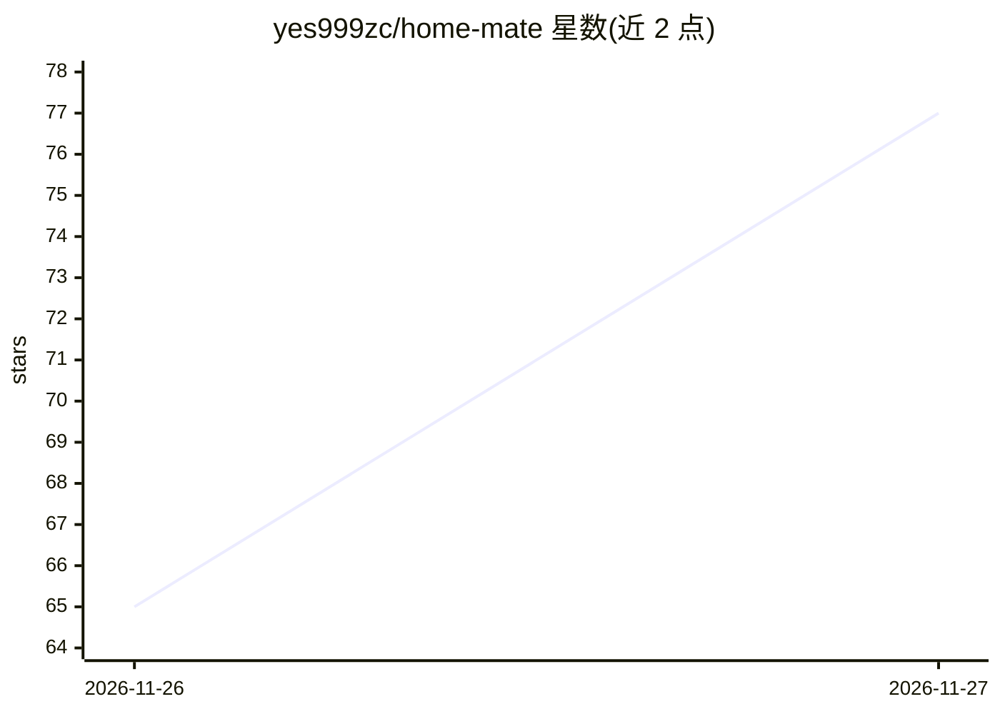

# yes999zc/home-mate

⭐ 77 · Rust · NOASSERTION · 推送 2026-11-25 · [GitHub](https://github.com/yes999zc/home-mate) · [官网](https://mymate.homes) · 个人维护 · 中文 README

**自托管 Rust 语音管家核心：跑在智能音箱或 NAS 上**

以纯 Rust 重写的家庭语音助手核心（hm-core + Vue 3 控制台 + hm-gateway + hm-kws），可整体运行在 ARM64 智能音箱（Echo Dot 2、小米 LX06）内部，或以 Docker 形态部署在 NAS/家庭服务器上同时管理多个网关设备。语音链路包含唤醒词（Zipformer/Silero VAD）、流式对话、本地打断，并通过 Home Assistant 实现带状态回读的设备控制闭环；长任务委托给外部 Master Brain Agent 网关。面向动手改造智能音箱与自建多房间语音系统的个人用户，README 声明仅供研究与个人非商业实验。

## 筛选速览

| 维度 | 判定 | 备注 |
|---|---|---|
| AI 角色 | `ai-native` | 本体是模型或模型工具 |
| 许可风险 | `none` | NOASSERTION |
| 部署形态 | `self-host` | docker 或自建部署 |
| 模型依赖 | — | README 未给出锁定关系 |
| 硬件要求 | — | 无带数字的原话,不猜 |
| 安装摩擦 | `low` | 无编译、无系统依赖或容器化 |
| 成熟度 | — | 结构信号不足 |

## 能力要点

- hm-core 可 100% 运行于 256 MB 内存音箱内，或 NAS Docker 多房间模式
- 自适应 256 MB/128 MB 小米 LX06 两批次硬件（读取 MemTotal 自动切换）
- 支持小米小爱与自定义唤醒词双唤醒共存，不改动原厂固件、可一键还原
- Home Assistant 闭环控制并强制执行后动作状态回读

## 适用场景

- 把闲置的小米音箱或 Echo Dot 2 改造成自己的语音助手终端
- 用 NAS 服务器统一管理全屋多个房间的语音入口
- 通过语音控制 Home Assistant 设备并要求播报执行结果

## 场景标签

`语音 Agent` · 领域:对话与助手

## 证据(README 行号)

> L13: **Home Mate (小瑞)** is the next-generation evolution of rui (小瑞), rewritten from scratch in **pure Rust** with a thr
> L19:  - The edge speaker handles low-latency wake, instant Q&A, music/stories/reminders, and closed-loop Home Assistant 
> L106:  5. LLM, ASR, TTS &amp; Master Brain (<code>/services</code>) Primary/fallback LLMs (DeepSeek / GLM / OpenAI), Qwe

## 星数曲线

2026-11-26 65 → 2026-11-27 77（+12）

---
*卡片 v1 · prompt 1.4 · 生成 2026-11-26 · 置信度 high · 依据 README sha `fd36740383c1` · [字段定义](../../DATASET.md)*
