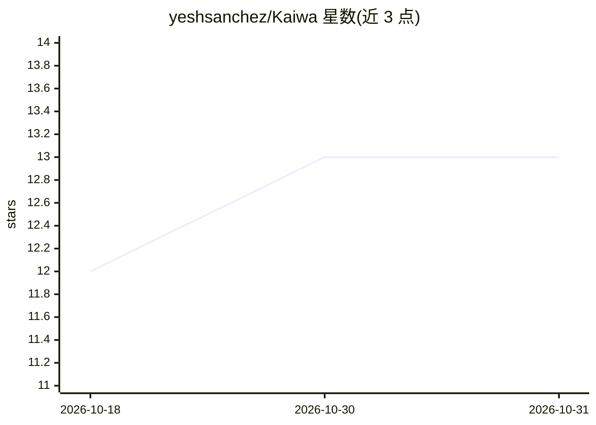

# yeshsanchez/Kaiwa

⭐ 13 · JavaScript · AGPL-3.0 · 推送 2026-08-14 · [GitHub](https://github.com/yeshsanchez/Kaiwa) · [官网](https://yeshsanchez.github.io/Kaiwa/) · 个人维护

**本地运行的日语会话 AI 导师：聊天、语音、角色扮演与复习**

面向日语学习者的本地优先桌面/网页应用（FastAPI + SQLite + vanilla JS）：提供 JLPT N5–N1 级别 AI 对话、实时语音通话（whisper.cpp STT + VOICEVOX/AivisSpeech/系统 TTS）、36 个角色扮演场景与自定义场景、10 节引导课程、逐句纠错、提示、假名/罗马音切换、JMdict 离线词典、Anki 式 SRS 复习、学习报告与备份。默认经 Ollama 运行本地模型，可选填 Gemini/OpenAI/Anthropic API key。macOS/Windows 提供安装包，也可从源码运行；源码路径的语音输入需单独安装 whisper.cpp。手机经 Tailscale 远程访问。

## 筛选速览

| 维度 | 判定 | 备注 |
|---|---|---|
| AI 角色 | `ai-native` | 本体是模型或模型工具 |
| 许可风险 | `viral` | AGPL-3.0 |
| 部署形态 | `desktop` | 安装包/桌面程序 |
| 模型依赖 | local-ok | 支持本地模型 |
| 硬件要求 | — | 无带数字的原话,不猜 |
| 安装摩擦 | `low` | 无编译、无系统依赖或容器化 |
| 成熟度 | — | 结构信号不足 |

## 能力要点

- 对话、语音通话、36 个角色扮演场景与逐句纠错
- 默认本地 AI：Ollama 首次启动向导检测硬件并推荐模型
- whisper.cpp 离线语音识别 + VOICEVOX/AivisSpeech 语音合成（安装包内置基础组件）
- JMdict 49 万条离线词典与 Anki 式 SRS 复习，数据存于单一 SQLite 文件

## 适用场景

- 和 AI 用日语自由对话或按场景角色扮演练口语
- 语音实时对话练听说，错误即时纠正并进入复习
- 离线、私密地学日语，不需要订阅和账号

## 场景标签

`语音 Agent` `聊天机器人` · 领域:对话与助手

## 证据(README 行号)

> L73: |💬 **Free Chat**|Natural conversation with Kaiwa, your AI tutor, at your JLPT level (N5–N1)|
> L92: - **Local AI (default)** — Ollama running a small model on

## 星数曲线

2026-10-18 12 → 2026-10-31 13（+1）

---
*卡片 v1 · prompt 1.4 · 生成 2026-10-31 · 置信度 high · 依据 README sha `55544d59da54` · [字段定义](../../DATASET.md)*
