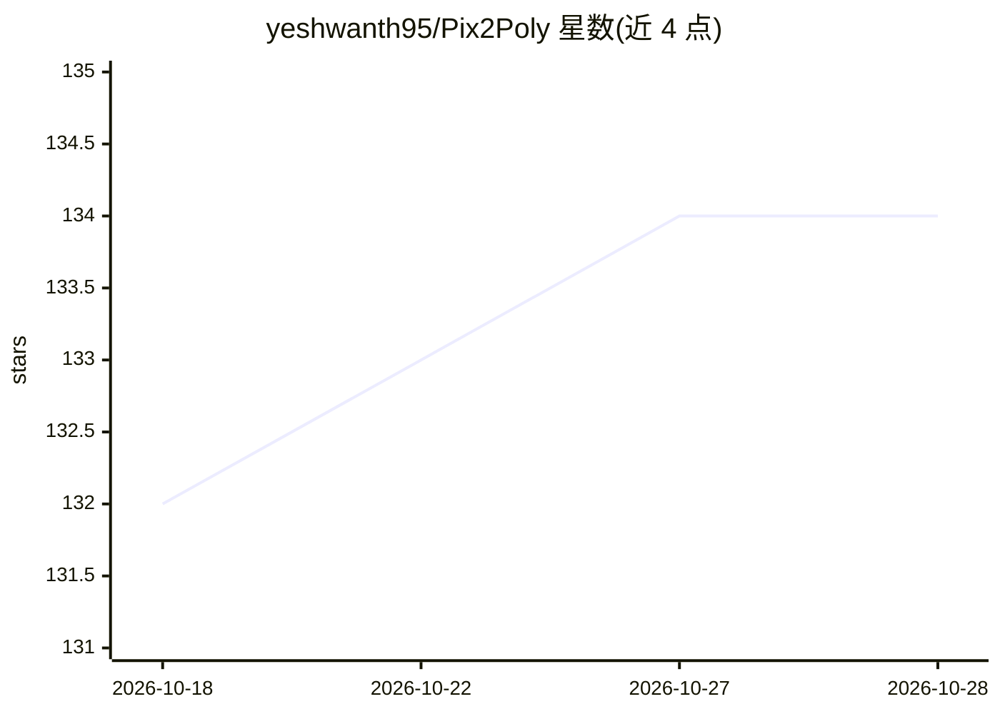

# yeshwanth95/Pix2Poly

⭐ 134 · Python · MIT · 推送 2026-06-01 · [GitHub](https://github.com/yeshwanth95/Pix2Poly) · 个人维护

**从遥感影像端到端提取建筑物多边形轮廓的深度学习模型**

WACV 2025 论文 Pix2Poly 的官方 PyTorch 实现：基于编码器-解码器 transformer 的生成式序列预测网络，直接输出建筑物角点坐标 token 序列，由最优匹配网络预测角点连接关系，恢复为环形图格式的矢量多边形，可提取建筑轮廓与道路网络。提供 conda 环境安装、多数据集（INRIA/SpaceNet 2/WHU/Massachusetts Roads）预训练权重下载、训练与推理脚本及评估指标（ciou/angle/polis/topdig）。需 Python 3.11、PyTorch 2.1.2、CUDA 11.8。

## 筛选速览

| 维度 | 判定 | 备注 |
|---|---|---|
| AI 角色 | `ai-native` | 本体是模型或模型工具 |
| 许可风险 | `permissive` | MIT |
| 部署形态 | `None` |  |
| 模型依赖 | — | README 未给出锁定关系 |
| 硬件要求 | — | 无带数字的原话,不猜 |
| 安装摩擦 | `medium` | 含编译或系统依赖之一 |
| 成熟度 | — | 结构信号不足 |

## 能力要点

- 端到端可微架构：序列化 tokenizer + Vertex Sequence Detector + 最优匹配网络
- 直接输出矢量多边形（环形图格式），无需栅格损失函数
- 提供多数据集预训练检查点与训练/推理/评估脚本
- 支持建筑物轮廓与道路网络提取

## 适用场景

- 从遥感影像批量提取矢量建筑物轮廓
- 制图与城市重建任务中生成矢量数据
- 复现论文实验或对比矢量形状质量指标

## 场景标签

`目标检测` · 领域:感知与多模态

## 证据(README 行号)

> L1: Pix2Poly: A Sequence Prediction Method for End-to-end Polygonal Building Footprint Extraction
> L15: Extraction of building footprint polygons from remotely sensed data is essential for several urban understanding ta

## 星数曲线

2026-10-18 132 → 2026-10-28 134（+2）

---
*卡片 v1 · prompt 1.4 · 生成 2026-10-22 · 置信度 high · 依据 README sha `8da3618ff4e8` · [字段定义](../../DATASET.md)*
