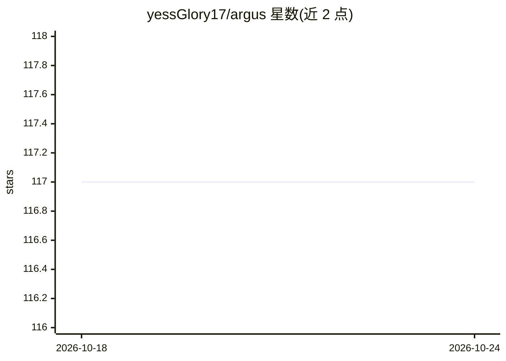

# yessGlory17/argus

⭐ 117 · TypeScript · MIT · 推送 2026-09-21 · [GitHub](https://github.com/yessGlory17/argus) · [官网](https://marketplace.visualstudio.com/items?itemName=argus-claude.argus-claude) · 个人维护

**VS Code 扩展：监控并分析 Claude Code 会话的执行轨迹与成本**

读取 Claude Code 写入 ~/.claude/projects/ 的 JSONL 转录文件，解析每次工具调用、提示与 token，输出含 Steps、Analysis、Cost、Performance、Flow、Context、Insights 七个页签的仪表盘。文件监听器支持会话实时流式更新；内置规则引擎标记重复读取、重试循环、失败工具、上下文压力与压缩事件；按步骤与会话统计 token 与美元成本及缓存命中率。面向开发者、团队与研究者，本地解析，转录不出本机。以 VSIX 安装或源码构建。

## 筛选速览

| 维度 | 判定 | 备注 |
|---|---|---|
| AI 角色 | `ai-ecosystem` | LLM/agent 周边工具 |
| 许可风险 | `permissive` | MIT |
| 部署形态 | `desktop` | 安装包/桌面程序 |
| 模型依赖 | — | README 未给出锁定关系 |
| 硬件要求 | — | 无带数字的原话,不猜 |
| 安装摩擦 | `low` | 无编译、无系统依赖或容器化 |
| 成熟度 | — | 结构信号不足 |

## 能力要点

- 解析 JSONL 转录并实时流式监控 Claude Code 会话
- 六条内置分析规则（重复读取/重试循环/失败工具/上下文压力等）
- 逐步骤与会话级 token+USD 成本与缓存归因
- D3 依赖图与子 agent 追踪

## 适用场景

- 查看 Claude Code 实际执行步骤与 token 花费
- 及早发现重试循环与重复读取造成的浪费
- 团队审计项目间 AI 使用成本并设预算
- 研究 LLM 工具调用分布与上下文压缩行为

## 场景标签

`LLM 可观测性` · 领域:评测与运维

## 证据(README 行号)

> L26: **Argus** is an open-source VS Code extension that brings deep monitoring and observability to your Claude Code age
> L28: Instead of treating each agent run as an opaque black box, Argus makes the full execution trace first-class: every 

## 星数曲线

2026-10-18 117 → 2026-10-24 117（+0）

---
*卡片 v1 · prompt 1.4 · 生成 2026-10-23 · 置信度 mid · 依据 README sha `c0118147694c` · [字段定义](../../DATASET.md)*
