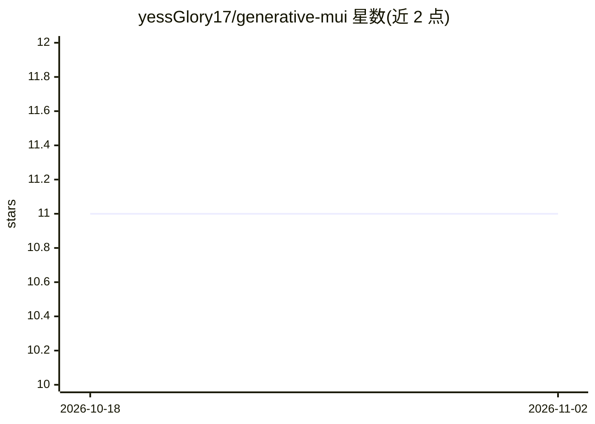

# yessGlory17/generative-mui

⭐ 11 · TypeScript · MIT · 推送 2026-07-24 · [GitHub](https://github.com/yessGlory17/generative-mui) · [官网](https://www.npmjs.com/package/@yessglory/generative-mui-react) · 个人维护

**把 LLM 输出的 A2UI 协议渲染成 Material UI 的 React 渲染库**

面向在 React/MUI 应用中实现生成式 UI 的开发者的渲染库：LLM 按谷歌 A2UI v0.9.1 协议输出流式 JSONL（组件按 id 引用的邻接表 + JSON-Pointer 绑定的数据模型），本库将其解析、经确定性 reducer 归约到 SurfaceStore，再渲染为宿主 ThemeProvider 内的真实 MUI 组件。双包结构：core 框架无关（Zod schema、解析、store），react 为 MUI 适配层。内建流式增量渲染、双向绑定、图表扩展目录与运行时自定义组件注册，未注册类型不渲染、agent 的 sx/style 不传入 MUI。三个示例（Gemini 浏览器/Next.js/MUI X Chat）演示模式无需 API key。

## 筛选速览

| 维度 | 判定 | 备注 |
|---|---|---|
| AI 角色 | `ai-ecosystem` | LLM/agent 周边工具 |
| 许可风险 | `permissive` | MIT |
| 部署形态 | `library` | 以包/库形式分发 |
| 模型依赖 | — | README 未给出锁定关系 |
| 硬件要求 | — | 无带数字的原话,不猜 |
| 安装摩擦 | `low` | 无编译、无系统依赖或容器化 |
| 成熟度 | — | 结构信号不足 |

## 能力要点

- A2UI 协议（JSONL 流式消息）确定性渲染为宿主主题内的 MUI 组件
- 双向绑定、增量渲染、组件级错误边界与 ReDoS 防护
- 18 个 Basic Catalog 组件一对一映射，扩展目录含图表/Table 等 16 个可选组件
- 运行时通过 registry/registerComponent 覆盖或新增组件类型

## 适用场景

- 给聊天机器人回复渲染结构化 UI（表单、表格、图表）而非纯文本
- 在现有 MUI 主题体系内安全呈现 LLM 生成的界面
- 为 agent 应用搭建生成式 UI 前端而无需逐场景手写组件

## 场景标签

 · 领域:前端/LLM 应用界面

## 证据(README 行号)

> L7: A renderer that maps Google's A2UI (v0.9.1) protocol onto **Material UI**.
> L23: `generative-mui` opens a third path. The model emits **data, not code**: A2UI, a flat, schema-validated,

## 星数曲线

2026-10-18 11 → 2026-11-02 11（+0）

---
*卡片 v1 · prompt 1.4 · 生成 2026-11-01 · 置信度 high · 依据 README sha `7deec4db8183` · [字段定义](../../DATASET.md)*
