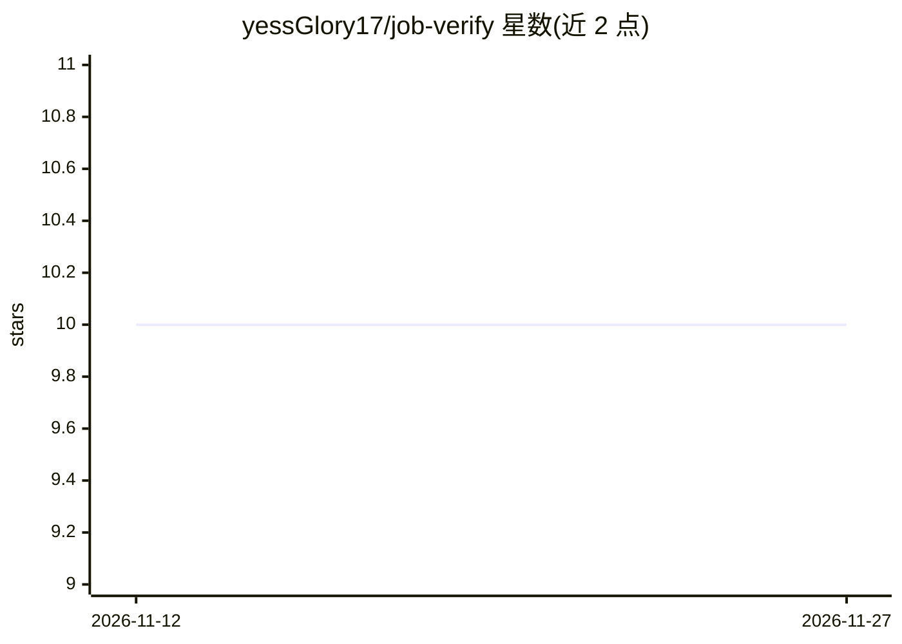

# yessGlory17/job-verify

⭐ 10 · Python · MIT · 推送 2026-07-03 · [GitHub](https://github.com/yessGlory17/job-verify) · 个人维护

**帮求职者核查招聘方与职位offer真伪的 MCP 服务器**

一个面向 Claude（Desktop/Code）的 MCP 服务器：用户粘贴招聘信息、公司名、链接或邮件，工具抽取实体（邮箱、域名、电话、加密钱包等）后对照公共工商注册、诈骗数据库、钓鱼黑名单、DNS 记录与 Internet Archive 网站历史等免费公开来源逐项核验，输出 looks legit / be careful / scam 三档判定及理由。无需 API key、账号或登录；不抓取 LinkedIn，仅读取公开信息；自我定位为决策支持而非确定性结论。通过 uv/uvx 从 GitHub 直接运行。

## 筛选速览

| 维度 | 判定 | 备注 |
|---|---|---|
| AI 角色 | `ai-native` | 本体是模型或模型工具 |
| 许可风险 | `permissive` | MIT |
| 部署形态 | `None` |  |
| 模型依赖 | — | README 未给出锁定关系 |
| 硬件要求 | — | 无带数字的原话,不猜 |
| 安装摩擦 | `low` | 无编译、无系统依赖或容器化 |
| 成熟度 | — | 结构信号不足 |

## 能力要点

- 20+ 个 OSINT 检查工具（邮箱、域名、钓鱼黑名单、证书透明度、SPF/DKIM 头解析等）
- 单一 analyze 提示词串联 抽取→检查→判定 完整流程
- 全部依赖免费公开来源，无需 API key，不存储用户数据
- 通过 uvx 从 GitHub 按需拉取运行，无需克隆或手动安装

## 适用场景

- 收到可疑招聘私信时核查公司注册与招募者身份
- 验证职位申请链接是否为钓鱼仿冒域名
- 检查对方提供的加密钱包地址是否已被标记为诈骗

## 场景标签

`网络安全` · 领域:学习与行业

## 证据(README 行号)

> L5:  MCP server
> L17: JobVerify quietly runs the same background checks a professional investigator would, then gives you a
> L136: Under the hood, the AI assistant orchestrates these individual checks (all free, no keys):

## 星数曲线

2026-11-12 10 → 2026-11-27 10（+0）

---
*卡片 v1 · prompt 1.4 · 生成 2026-11-19 · 置信度 high · 依据 README sha `050b5e279ebc` · [字段定义](../../DATASET.md)*
