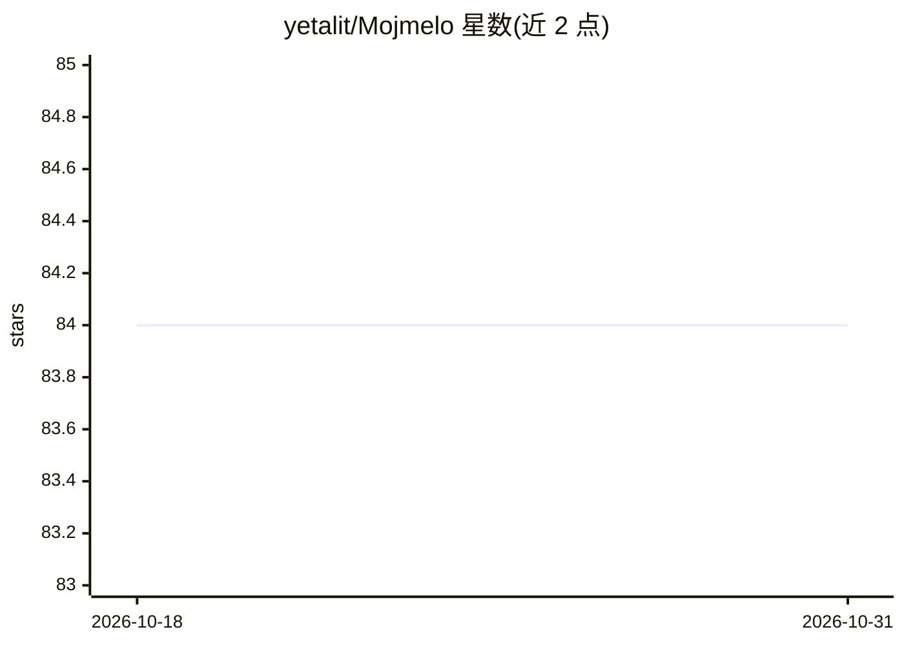

# yetalit/Mojmelo

⭐ 84 · Mojo · BSD-3-Clause · 推送 2026-10-23 · [GitHub](https://github.com/yetalit/Mojmelo) · [官网](https://yetalit.github.io/Mojmelo/index.html) · 个人维护

**纯 Mojo 实现的机器学习算法库，供 Mojo 项目训练与预测**

用纯 Mojo 从零实现的机器学习算法库，覆盖线性/多项式/逻辑回归、KNN、KMeans、DBSCAN、HDBSCAN、SVM、朴素贝叶斯、决策树、随机森林、GBDT 与 PCA，并提供 normalize、MinMaxScaler、StandardScaler、KFold、GridSearchCV 等预处理与工具模块，附带自有 Matrix 线性代数实现。面向使用 Mojo 语言的开发者，需要 mojo-compiler 1.2.0+；支持 Pixi、PyPI（pip install mojmelo 后运行 mojmelo-setup）与源码三种安装方式，安装后需运行基准测试完成 setup。README 列出与 sklearn 等在 AMD Zen 4 上的耗时对比数据。

## 筛选速览

| 维度 | 判定 | 备注 |
|---|---|---|
| AI 角色 | `ai-native` | 本体是模型或模型工具 |
| 许可风险 | `permissive` | BSD-3-Clause |
| 部署形态 | `library` | 以包/库形式分发 |
| 模型依赖 | — | README 未给出锁定关系 |
| 硬件要求 | — | 无带数字的原话,不猜 |
| 安装摩擦 | `low` | 无编译、无系统依赖或容器化 |
| 成熟度 | — | 结构信号不足 |

## 能力要点

- 纯 Mojo 从零实现 15 类机器学习算法
- 含预处理与调参工具（GridSearchCV/KFold/LabelEncoder 等）
- 附带自有 linalg.Matrix 矩阵实现
- README 提供 KMeans/SVM/KNN 等与 sklearn 的基准测试数据

## 适用场景

- 在 Mojo 项目中直接训练回归、分类与聚类模型
- 用纯 Mojo 生态完成数据预处理与网格搜索调参
- 对比 Mojo 与 sklearn 实现的运行性能

## 场景标签

 · 领域:机器学习/算法库

## 证据(README 行号)

> L16: The name `Mojmelo` is derived from the "Mojo Machine Learning" expression. It includes the implementation of Machin
> L18: * Linear Regression
> L51: * mojo-compiler 1.2.0 or later

## 星数曲线

2026-10-18 84 → 2026-10-31 84（+0）

---
*卡片 v1 · prompt 1.4 · 生成 2026-10-24 · 置信度 high · 依据 README sha `a354d226e837` · [字段定义](../../DATASET.md)*
