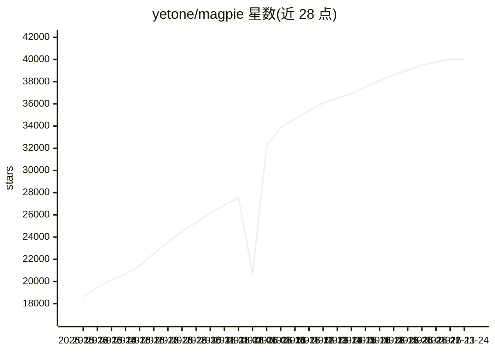

# yetone/magpie

⭐ 40,014 · Go · MIT · 推送 2026-11-22 · [GitHub](https://github.com/yetone/magpie) · [官网](https://usemagpie.ai) · 个人维护 · 中文 README

**把各编码 agent 的模型与账号接入统一本地网关的菜单栏应用**

magpie 在本机 127.0.0.1:3425 运行一个本地网关，将 Claude Code、Codex、Gemini CLI 等 agent 的模型配置收敛到一个应用中：它改写各 agent 自身配置文件的模型项，提供 provider 预设与订阅账号登录，配额耗尽时在账号与路由组间切换。网关在 OpenAI Chat/Responses、Anthropic Messages 与 Gemini 协议间做翻译，含流式、工具调用与推理。另提供提示词中密钥的本地脱敏（默认关闭）、路由组（smart/order/rotate/usage/pace 五种模式）、插件系统（运行于 Bun）。支持 macOS/Windows/Linux/Docker/Termux，含菜单栏、TUI、Web UI 与 CLI 形态。

## 筛选速览

| 维度 | 判定 | 备注 |
|---|---|---|
| AI 角色 | `ai-ecosystem` | LLM/agent 周边工具 |
| 许可风险 | `permissive` | MIT |
| 部署形态 | `library` | 以包/库形式分发 |
| 模型依赖 | local-ok | 支持本地模型 |
| 硬件要求 | — | 无带数字的原话,不猜 |
| 安装摩擦 | `low` | 无编译、无系统依赖或容器化 |
| 成熟度 | — | 结构信号不足 |

## 动量与使用信号

- 维护:`active` — 距上次 push 0.7 天,年发版 89,126 位贡献者
- 涨星:近 1 天 **+1,002**(自 20261016 起算)
- 平台:WINDOWS / MACOS / LINUX / ANDROID / WEB · 协议:MCP / OLLAMA

## 能力要点

- 本地网关翻译 OpenAI/Anthropic/Gemini 协议，含流式、工具调用与推理
- 路由组五种模式与多账号配额故障切换
- 提示词中密钥/邮箱的本地脱敏与占位符还原（默认关闭）
- 插件系统运行于 Bun，支持 npm 上的 OpenCode 插件

## 适用场景

- 让 Claude Code 使用 DeepSeek/Kimi 等其他模型的 API key
- 多个订阅账号间自动切换以在配额耗尽时继续工作
- 在一个列表里为多个 agent 统一挑选与切换模型
- 在请求离开本机前对提示词中的密钥做脱敏

## 场景标签

`模型网关` · 领域:Agent 开发

## 证据(README 行号)

> L8: Switch any of them from the menu bar. One local gateway serves them all,
> L78: The gateway at `127.0.0.1:3425` speaks OpenAI Chat, OpenAI Responses, Anthropic Messages and Gemini, and translates
> L80:  How magpie fits together: your agents send requests to the magpie gateway at 127.0.0.1:3425, which routes them thr

## 星数曲线

2026-10-22 18,635 → 2026-11-24 40,014（+21,379）

---
*卡片 v1 · prompt 1.4 · 生成 2026-11-23 · 置信度 high · 依据 README sha `cdacab7d5adf` · [字段定义](../../DATASET.md)*
