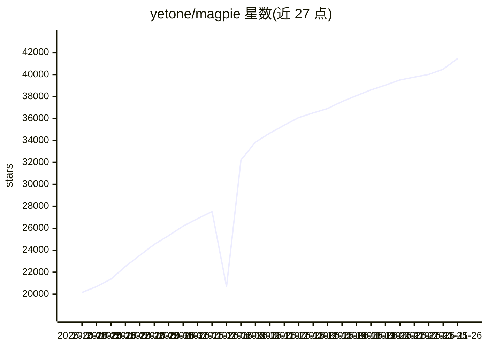

# yetone/magpie

⭐ 41,464 · Go · MIT · 推送 2026-11-25 · [GitHub](https://github.com/yetone/magpie) · [官网](https://usemagpie.ai) · 个人维护 · 中文 README

**本地网关应用：给各 AI Agent 统一切换模型与账号**

一个运行在菜单栏/终端的本地网关应用，把多个 AI Agent（Claude Code、Codex、Gemini CLI 等）的模型配置收拢到一处：向任意 Agent 指派任意 provider 的模型，改写 Agent 自身配置文件；网关在 127.0.0.1:3425 互译 OpenAI/Anthropic/Gemini 协议（含流式、工具调用、推理内容）。支持订阅账号发现与多账号配额故障切换、路由组（smart/order/rotate/usage/pace）、本地隐私掩码（默认关闭）、npm 插件体系。面向同时使用多个 Agent、多个 provider 或多个账号的用户。

## 筛选速览

| 维度 | 判定 | 备注 |
|---|---|---|
| AI 角色 | `ai-ecosystem` | LLM/agent 周边工具 |
| 许可风险 | `permissive` | MIT |
| 部署形态 | `library` | 以包/库形式分发 |
| 模型依赖 | local-ok | 支持本地模型 |
| 硬件要求 | — | 无带数字的原话,不猜 |
| 安装摩擦 | `low` | 无编译、无系统依赖或容器化 |
| 成熟度 | — | 结构信号不足 |

## 动量与使用信号

- 维护:`active` — 距上次 push 0.7 天,年发版 89,126 位贡献者
- 涨星:近 1 天 **+1,002**(自 20261016 起算)
- 平台:WINDOWS / MACOS / LINUX / ANDROID / WEB · 协议:MCP / OLLAMA

## 能力要点

- 本地网关互译 OpenAI/Anthropic/Gemini 协议，含流式、工具调用与推理
- 配额用尽自动切换下一账号，路由组按 5 种策略分派请求
- 本地掩码：密钥/密码/邮箱在请求发出前替换为占位符并在回复中还原
- 支持约 80 个已列名 Agent，任何接受 base URL 的工具可直连网关

## 适用场景

- 一个订阅配额用完时自动切到下一个账号，Agent 不报错
- 给 Claude Code 换上 DeepSeek 或 Kimi 的模型
- 多个 Agent 统一在一处管理和切换模型
- 在本地掩码密钥后再发给模型厂商

## 场景标签

`模型网关` · 领域:Agent 开发

## 证据(README 行号)

> L28: Each agent keeps its model in its own file, in its own format, with its own keys and base URLs. A subscription you 
> L78: The gateway at `127.0.0.1:3425` speaks OpenAI Chat, OpenAI Responses, Anthropic Messages and Gemini, and translates
> L80:  How magpie fits together: your agents send requests to the magpie gateway at 127.0.0.1:3425, which routes them thr

## 星数曲线

2026-10-24 20,159 → 2026-11-26 41,464（+21,305）

---
*卡片 v1 · prompt 1.4 · 生成 2026-11-24 · 置信度 high · 依据 README sha `db92ec4c34db` · [字段定义](../../DATASET.md)*
