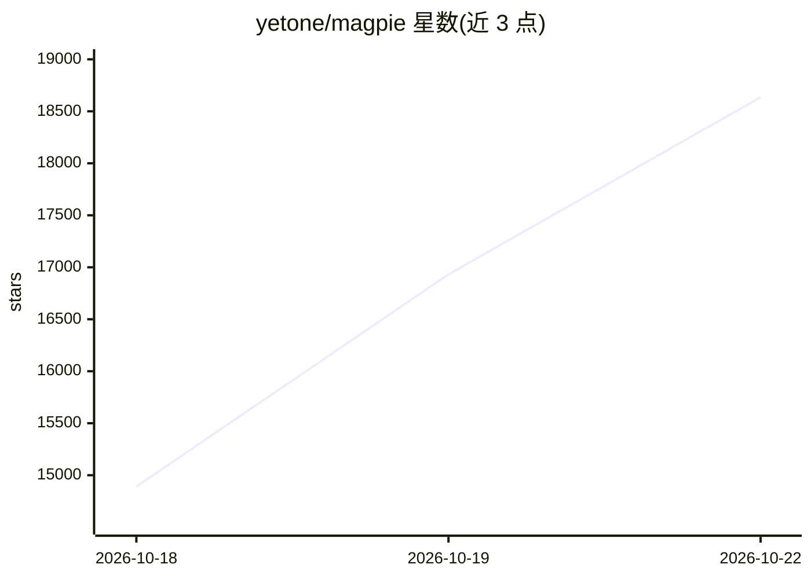

# yetone/magpie

⭐ 19,477 · Go · MIT · 推送 2026-10-22 · [GitHub](https://github.com/yetone/magpie) · [官网](https://usemagpie.ai) · 个人维护 · 中文 README

**给多 AI agent 统一切换模型与账号的本地网关**

面向同时使用多个编码 agent（Claude Code、Codex、Gemini CLI 等 70 余种）的用户：在菜单栏/CLI/Web UI 中为任一 agent 指定任一提供商或订阅的模型，通过本机 127.0.0.1:3425 网关在 OpenAI/Anthropic/Gemini 协议间转换。支持订阅账号复用、配额耗尽自动切换（smart/order/rotate 等路由组）、用量成本统计、Bun 插件与中间件、局域网共享与 Docker 部署。运行于 macOS/Windows/Linux，mac 构建已签名公证。

## 筛选速览

| 维度 | 判定 | 备注 |
|---|---|---|
| AI 角色 | `ai-ecosystem` | LLM/agent 周边工具 |
| 许可风险 | `permissive` | MIT |
| 部署形态 | `library` | 以包/库形式分发 |
| 模型依赖 | local-ok | 支持本地模型 |
| 硬件要求 | — | 无带数字的原话,不猜 |
| 安装摩擦 | `low` | 无编译、无系统依赖或容器化 |
| 成熟度 | — | 结构信号不足 |

## 动量与使用信号

- 维护:`active` — 距上次 push 0.7 天,年发版 89,126 位贡献者
- 涨星:近 1 天 **+1,002**(自 20261016 起算)
- 平台:WINDOWS / MACOS / LINUX / ANDROID / WEB · 协议:MCP / OLLAMA

## 能力要点

- 本地网关转换 OpenAI/Anthropic/Gemini 协议，服务 70+ 种 agent
- 路由组在配额耗尽时自动切换账号/模型
- 订阅账号（Claude/ChatGPT/Copilot 等）可跨 agent 复用
- Bun 插件与网关中间件、用量成本与配额统计

## 适用场景

- 让 Claude Code 用 DeepSeek、Codex 用 Kimi 等自由组合模型
- 多账号订阅配额耗尽时自动切换不断服务
- 团队在局域网内共享一个网关并按 key 限额

## 场景标签

`模型网关` · 领域:Agent 开发

## 证据(README 行号)

> L8: Switch any of them from the menu bar. One local gateway serves them all,
> L72: The gateway at `127.0.0.1:3425` speaks OpenAI Chat, OpenAI Responses, Anthropic Messages and Gemini, and translates

## 星数曲线

2026-10-18 14,891 → 2026-10-22 18,635（+3,744）

---
*卡片 v1 · prompt 1.4 · 生成 2026-10-20 · 置信度 high · 依据 README sha `162b18bc5149` · [字段定义](../../DATASET.md)*
