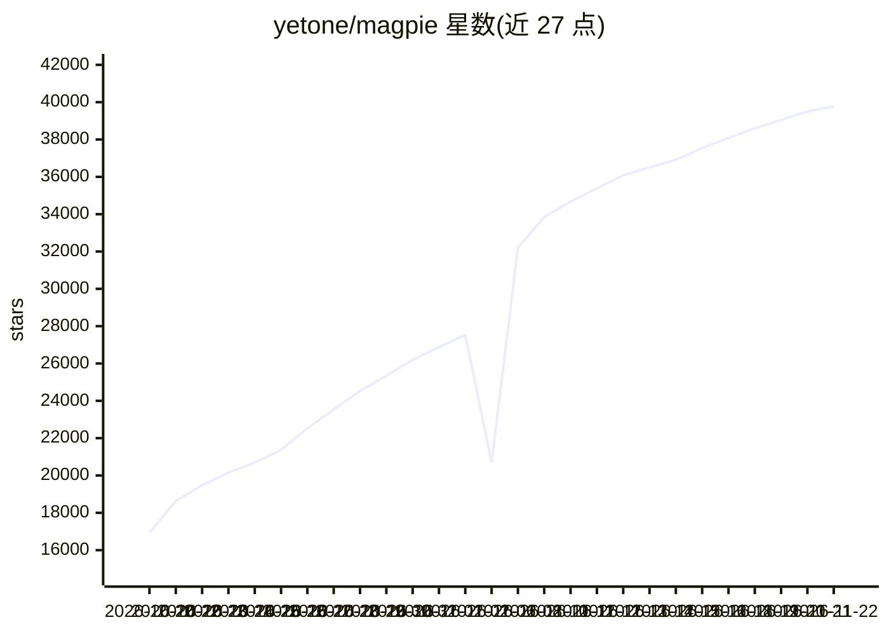

# yetone/magpie

⭐ 39,767 · Go · MIT · 推送 2026-11-21 · [GitHub](https://github.com/yetone/magpie) · [官网](https://usemagpie.ai) · 个人维护 · 中文 README

**统一管理多个 AI Agent 模型与账号的本地网关**

magpie 将各 Agent（Claude Code、Codex、Gemini CLI 等 90 余个）各自独立的模型配置、密钥与订阅账号整合到一个应用和一个本地网关（127.0.0.1:3425）之后：从统一列表为任意 Agent 选取任意模型，支持配额用尽后自动切换到下一账号或路由组内的其他模型/提供商，网关在 OpenAI、Anthropic、Gemini 协议间互译并提供流式与工具调用。还提供本地隐私掩码（默认关闭）、路由组（smart/order/rotate/usage/pace 五种模式）、npm 插件系统与网关中间件。菜单栏应用、TUI、Web UI 与 CLI 形态，支持 macOS/Windows/Linux/Docker/Termux。

## 筛选速览

| 维度 | 判定 | 备注 |
|---|---|---|
| AI 角色 | `ai-ecosystem` | LLM/agent 周边工具 |
| 许可风险 | `permissive` | MIT |
| 部署形态 | `library` | 以包/库形式分发 |
| 模型依赖 | local-ok | 支持本地模型 |
| 硬件要求 | — | 无带数字的原话,不猜 |
| 安装摩擦 | `low` | 无编译、无系统依赖或容器化 |
| 成熟度 | — | 结构信号不足 |

## 动量与使用信号

- 维护:`active` — 距上次 push 0.7 天,年发版 89,126 位贡献者
- 涨星:近 1 天 **+1,002**(自 20261016 起算)
- 平台:WINDOWS / MACOS / LINUX / ANDROID / WEB · 协议:MCP / OLLAMA

## 能力要点

- 本地网关互译 OpenAI/Anthropic/Gemini 协议，含流式、工具调用与 reasoning
- 配额耗尽自动切换账号，路由组五种模式，会话粘住同一账号以保 prompt 缓存
- 本地隐私掩码：密钥/密码/邮箱在请求离开本机前替换为占位符
- npm 插件系统与网关中间件（onRequest/onEvent/onResponse）

## 适用场景

- 多个 Agent 共用一份 API key 或订阅账号
- 主账号配额用完时自动落到备用账号或备用模型
- 在提示词中遮蔽密钥、密码等敏感值后再发给厂商

## 场景标签

`模型网关` · 领域:Agent 开发

## 证据(README 行号)

> L8: Switch any of them from the menu bar. One local gateway serves them all,
> L78: The gateway at `127.0.0.1:3425` speaks OpenAI Chat, OpenAI Responses, Anthropic Messages and Gemini, and translates
> L113: > **Presets include** Anthropic · OpenAI · Google Gemini · Google Vertex AI · Amazon Bedrock (runtime and Mantle) 

## 星数曲线

2026-10-20 16,932 → 2026-11-22 39,767（+22,835）

---
*卡片 v1 · prompt 1.4 · 生成 2026-11-22 · 置信度 high · 依据 README sha `052327525f58` · [字段定义](../../DATASET.md)*
