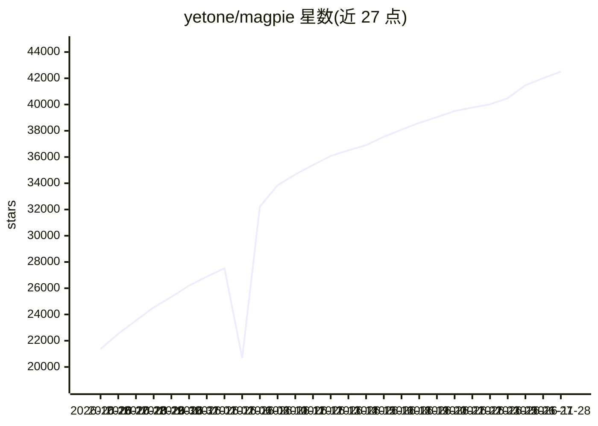

# yetone/magpie

⭐ 42,510 · Go · MIT · 推送 2026-11-27 · [GitHub](https://github.com/yetone/magpie) · [官网](https://usemagpie.ai) · 个人维护 · 中文 README

**把多个订阅计划池化供任意 agent 使用的本地网关**

本地运行的应用与网关：将用户已付费的多个订阅计划（Claude、ChatGPT、Copilot、GLM Coding Plan、Kimi Code 等）与 API key、本地模型汇集到一处，通过 127.0.0.1:3425 网关在四种协议间翻译，供 80+ 个 agent（Claude Code、Codex、Gemini CLI 等）以任意模型调用。配额耗尽时按路由组（smart/order/rotate/usage/pace 五种模式）在账户与模型间切换；另提供本机隐私脱敏、订阅账户发现、Bun 插件机制。提供桌面/TUI/CLI/Docker/Termux 多种运行形态，可一键卸载还原 agent 配置。

## 筛选速览

| 维度 | 判定 | 备注 |
|---|---|---|
| AI 角色 | `ai-ecosystem` | LLM/agent 周边工具 |
| 许可风险 | `permissive` | MIT |
| 部署形态 | `library` | 以包/库形式分发 |
| 模型依赖 | local-ok | 支持本地模型 |
| 硬件要求 | — | 无带数字的原话,不猜 |
| 安装摩擦 | `low` | 无编译、无系统依赖或容器化 |
| 成熟度 | — | 结构信号不足 |

## 动量与使用信号

- 维护:`active` — 距上次 push 0.7 天,年发版 89,126 位贡献者
- 涨星:近 1 天 **+1,002**(自 20261016 起算)
- 平台:WINDOWS / MACOS / LINUX / ANDROID / WEB · 协议:MCP / OLLAMA

## 能力要点

- 本地网关翻译 OpenAI Chat/Responses、Anthropic Messages 与 Gemini 协议（含流式、工具调用、推理）
- 五种路由模式在账户与模型间做配额切换与故障转移
- 默认关闭的本机脱敏：key/邮箱/密码在请求发出前替换为占位符，回复中还原
- 通过读取 agent 本地登录文件发现订阅账户，可关闭

## 适用场景

- 同时使用多个 agent，想让每个都能调用我全部已付费的订阅计划
- 某计划配额用完后自动切到下一个账户或模型，避免 agent 报错
- 在发往厂商的请求前脱敏 prompt 里的密钥与个人信息
- 把测试请求路由到强模型、简单问题路由到便宜模型

## 场景标签

`模型网关` · 领域:Agent 开发

## 证据(README 行号)

> L28: Each agent keeps its model in its own file, in its own format, with its own keys and base URLs. A subscription you 
> L78: The gateway at `127.0.0.1:3425` speaks OpenAI Chat, OpenAI Responses, Anthropic Messages and Gemini, and translates
> L80:  How magpie fits together: your agents send requests to the magpie gateway at 127.0.0.1:3425, which routes them thr

## 星数曲线

2026-10-26 21,370 → 2026-11-28 42,510（+21,140）

---
*卡片 v1 · prompt 1.4 · 生成 2026-11-28 · 置信度 high · 依据 README sha `e58224f8e975` · [字段定义](../../DATASET.md)*
