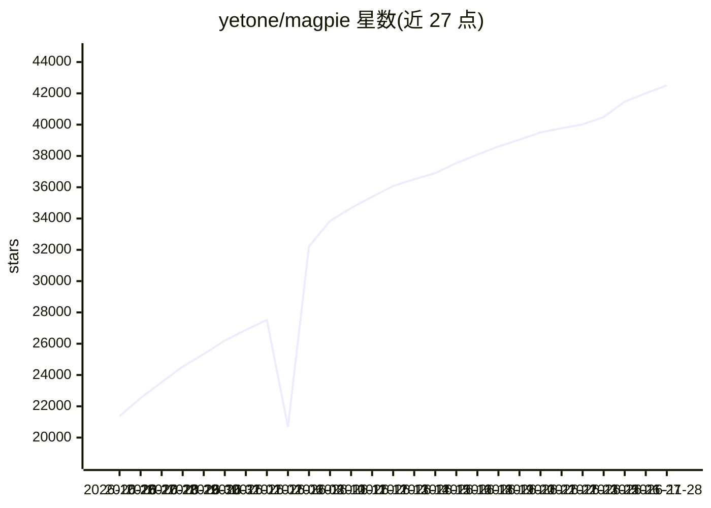

# yetone/magpie

⭐ 42,510 · Go · MIT · 推送 2026-11-27 · [GitHub](https://github.com/yetone/magpie) · [官网](https://usemagpie.ai) · 个人维护 · 中文 README

**把多个已付费订阅池化的本地网关，供各 agent 共用**

magpie 是一个本地网关应用：将用户购买的多个模型订阅与 API key（Claude、ChatGPT、Copilot、GLM、Kimi Code 等）汇聚为一个池，通过 127.0.0.1:3425 的网关以 OpenAI Chat/Responses、Anthropic Messages、Gemini 协议对外提供服务，供 80+ 个 agent 客户端按需选用任意模型。核心机制包括配额耗尽时的多账户/路由组接管（smart/order/rotate/usage/pace 五种策略）、订阅登录信息读取、可选的本机隐私掩码（默认关闭，密钥/邮箱等在请求离开前替换为占位符）、插件系统（运行于 Bun）。提供 GUI、TUI、CLI、Docker 与 Termux 形态。

## 筛选速览

| 维度 | 判定 | 备注 |
|---|---|---|
| AI 角色 | `ai-ecosystem` | LLM/agent 周边工具 |
| 许可风险 | `permissive` | MIT |
| 部署形态 | `library` | 以包/库形式分发 |
| 模型依赖 | local-ok | 支持本地模型 |
| 硬件要求 | — | 无带数字的原话,不猜 |
| 安装摩擦 | `low` | 无编译、无系统依赖或容器化 |
| 成熟度 | — | 结构信号不足 |

## 动量与使用信号

- 维护:`active` — 距上次 push 0.7 天,年发版 89,126 位贡献者
- 涨星:近 1 天 **+1,002**(自 20261016 起算)
- 平台:WINDOWS / MACOS / LINUX / ANDROID / WEB · 协议:MCP / OLLAMA

## 能力要点

- 本地网关翻译 OpenAI/Anthropic/Gemini 协议，含流式、工具调用与推理
- 路由组在订阅配额耗尽时按 5 种策略切换账户/模型
- 可选隐私掩码：本机替换敏感值并在回复中还原，仅驻内存
- 支持 80+ agent 与任意 OpenAI/Anthropic 兼容 base URL 接入

## 适用场景

- 同时使用多个 agent 客户端并复用已有付费订阅
- 单个订阅配额用尽后自动切换到下一个账户/模型继续工作
- 在发送给厂商的请求前掩码提示中的密钥与个人数据

## 场景标签

`模型网关` `编码 Agent` · 领域:Agent 开发

## 证据(README 行号)

> L28: Each agent keeps its model in its own file, in its own format, with its own keys and base URLs. A subscription you 
> L37: Runs on macOS, Windows and Linux (menu bar app, window, TUI, web UI and CLI), in Docker, and on Termux.

## 星数曲线

2026-10-26 21,370 → 2026-11-28 42,510（+21,140）

---
*卡片 v1 · prompt 1.4 · 生成 2026-11-27 · 置信度 high · 依据 README sha `d47f42264385` · [字段定义](../../DATASET.md)*
