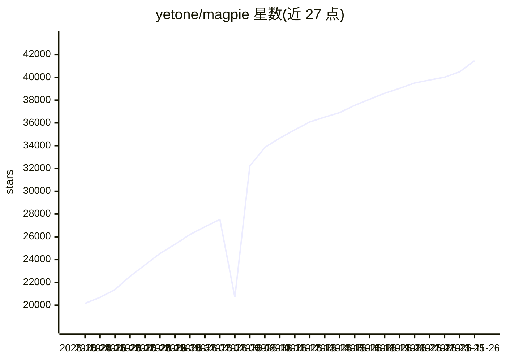

# yetone/magpie

⭐ 41,464 · Go · MIT · 推送 2026-11-25 · [GitHub](https://github.com/yetone/magpie) · [官网](https://usemagpie.ai) · 个人维护 · 中文 README

**菜单栏本地网关：给各 AI 编码代理统一切换模型与账号**

magpie 是一个本地网关与菜单栏应用，把各代理工具各自的模型配置收拢到一处：用户在列表里为任一代理任选 provider/model，magpie 原子化改写代理自身配置；本地网关（127.0.0.1:3425）翻译 OpenAI Chat/Responses、Anthropic Messages 与 Gemini 协议，含流式、工具调用与推理内容。支持多账号配额耗尽自动切换（smart/order/rotate/usage/pace 等路由模式）、订阅复用、隐私掩码（默认关闭）与 npm 插件。面向同时使用多个代理、多个 provider 或多个账号的用户；单一代理单一订阅的用户无需它。

## 筛选速览

| 维度 | 判定 | 备注 |
|---|---|---|
| AI 角色 | `ai-ecosystem` | LLM/agent 周边工具 |
| 许可风险 | `permissive` | MIT |
| 部署形态 | `library` | 以包/库形式分发 |
| 模型依赖 | local-ok | 支持本地模型 |
| 硬件要求 | — | 无带数字的原话,不猜 |
| 安装摩擦 | `low` | 无编译、无系统依赖或容器化 |
| 成熟度 | — | 结构信号不足 |

## 动量与使用信号

- 维护:`active` — 距上次 push 0.7 天,年发版 89,126 位贡献者
- 涨星:近 1 天 **+1,002**(自 20261016 起算)
- 平台:WINDOWS / MACOS / LINUX / ANDROID / WEB · 协议:MCP / OLLAMA

## 能力要点

- 本地网关翻译并转发 OpenAI/Anthropic/Gemini 三类协议，含流式、工具调用与 reasoning
- 路由组在多个模型/账号间切换，代理不感知配额报错
- 本地隐私掩码：密钥/邮箱等在请求发出前替换为占位符并回填
- 支持 macOS/Windows/Linux/Docker/Termux，GUI、TUI、Web UI 与 CLI 多形态

## 适用场景

- 为 Claude Code、Codex、Gemini CLI 等代理统一挑选和切换模型
- 配额耗尽时在多个账号/模型间自动接管，避免中断
- 在多个代理间复用同一份订阅或 API key
- 在本地掩码提示词中的密钥后再发给厂商

## 场景标签

`模型网关` · 领域:Agent 开发

## 证据(README 行号)

> L8: Switch any of them from the menu bar. One local gateway serves them all,
> L78: The gateway at `127.0.0.1:3425` speaks OpenAI Chat, OpenAI Responses, Anthropic Messages and Gemini, and translates
> L35: It's for you if you use more than one agent, more than one provider, or more than one account. If you use one agent

## 星数曲线

2026-10-24 20,159 → 2026-11-26 41,464（+21,305）

---
*卡片 v1 · prompt 1.4 · 生成 2026-11-26 · 置信度 high · 依据 README sha `091fc36cf29d` · [字段定义](../../DATASET.md)*
