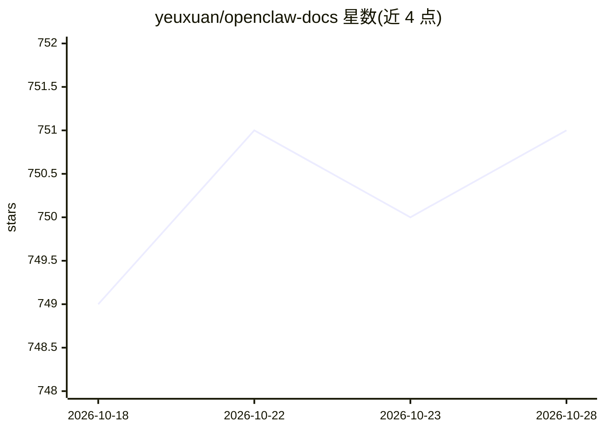

# yeuxuan/openclaw-docs

⭐ 751 · JavaScript · 推送 2026-10-08 · [GitHub](https://github.com/yeuxuan/openclaw-docs) · [官网](https://openclaw-docs.dx3n.cn) · 个人维护 · 中文 README

**OpenClaw 中文文档站：767 篇安装与源码剖析教程**

面向中文读者的 OpenClaw 教程文档站（VitePress 构建），收录 767 篇中文教程，分 4 条主线：安装教程（680 篇，覆盖安装、Web 控制 UI、节点、AI 服务商接入、通道接入、Gateway 运维）、完整工程主线（62 篇，含函数级源码剖析）、AI 核心框架（24 篇）与通道适配器。文档对象 OpenClaw 是自托管多通道 AI 助手平台，支持 WhatsApp/Telegram/飞书等 18+ 聊天通道与多家模型接入。本仓库本体是文档源码，可本地运行或部署到 Azure Static Web Apps。

## 筛选速览

| 维度 | 判定 | 备注 |
|---|---|---|
| AI 角色 | `ai-knowledge` | 知识聚合/清单类 |
| 许可风险 | `none` | — |
| 部署形态 | `library` | 以包/库形式分发 |
| 模型依赖 | — | README 未给出锁定关系 |
| 硬件要求 | — | 无带数字的原话,不猜 |
| 安装摩擦 | `low` | 无编译、无系统依赖或容器化 |
| 成熟度 | — | 结构信号不足 |

## 能力要点

- 767 篇中文教程，4 条学习主线组织
- 函数级精度的源码剖析（关键模块到具体函数与调用链）
- VitePress 文档站，本地可运行与构建静态产物
- 覆盖 OpenClaw 的安装、Gateway 运维、通道接入、AI 服务商接入

## 适用场景

- 零基础按教程安装并运行 OpenClaw 平台
- 跟随源码剖析理解 OpenClaw 的 Gateway 与 Agent 执行链路
- 查找通道适配器与 AI 模型接入的配置方法

## 场景标签

`教程课程` · 领域:学习与行业

## 证据(README 行号)

> L3: > **OpenClaw** 是自托管的多通道 AI 助手平台，通过 Gateway 统一连接 Web 控制 UI、聊天通道、节点、工具和模型。本仓库是面向中文读者的教程站，目标是把官方最新架构讲到足够清楚：先让新手能跑起来，再带开
> L14: 本文档站包含 **767 篇**中文教程，分为 4 条学习主线：
> L18: |**Track 0** 安装教程|零基础照着做、快速安装、onboard、Web 控制 UI、节点、AI 服务商接入、通道接入、Gateway 运维、常见问题排查|680 篇|→ 教程中心|

## 星数曲线

2026-10-18 749 → 2026-10-28 751（+2）

---
*卡片 v1 · prompt 1.4 · 生成 2026-10-21 · 置信度 high · 依据 README sha `576fdce6035f` · [字段定义](../../DATASET.md)*
