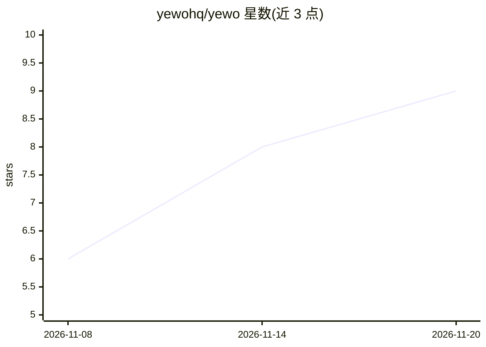

# yewohq/yewo

⭐ 9 · Python · Apache-2.0 · 推送 2026-11-13 · [GitHub](https://github.com/yewohq/yewo) · [官网](https://tryyewo.dev) · 个人维护

**AI 驱动的 Android/iOS 端到端测试 Agent**

以自然语言描述用户旅程，Agent 操作真实应用执行测试：通过视觉模型识别屏幕控件与点击位置，不依赖 accessibility ID 等应用内选择器；流程为发现旅程→生成场景→执行→独立审计→报告。执行器与审计者分离，仅以截图等可见证据判定 passed/failed/unverified 等结论。输出 JSON/HTML/Markdown/JUnit 报告。当前为 alpha 阶段，接口可能变更；iOS 测试仅限 macOS 主机。

## 筛选速览

| 维度 | 判定 | 备注 |
|---|---|---|
| AI 角色 | `ai-native` | 本体是模型或模型工具 |
| 许可风险 | `permissive` | Apache-2.0 |
| 部署形态 | `library` | 以包/库形式分发 |
| 模型依赖 | — | README 未给出锁定关系 |
| 硬件要求 | — | 无带数字的原话,不猜 |
| 安装摩擦 | `low` | 无编译、无系统依赖或容器化 |
| 成熟度 | `idea` | |

## 能力要点

- 自然语言驱动真实 Android/iOS 应用执行测试
- 视觉模型定位控件，不依赖测试 ID 或应用内选择器
- 执行与审计分离，结论须由保存的证据支撑
- 生成 JSON/HTML/Markdown/JUnit 报告，JUnit 兼容 CI

## 适用场景

- 用自然语言对 App 做探索性测试
- 为既有用户旅程生成并运行可复用的回归测试场景
- 在 CI 中消费 JUnit 格式的移动端测试报告

## 场景标签

 · 领域:软件测试/移动开发工具

## 证据(README 行号)

> L3: Yewo is an AI testing agent for Android and iOS apps. Describe a user journey
> L4: in plain language and Yewo operates the real app, checks what happened, and
> L137: During discovery, Yewo analyzes screenshots with a configured visual model,

## 星数曲线

2026-11-08 6 → 2026-11-20 9（+3）

---
*卡片 v1 · prompt 1.4 · 生成 2026-11-20 · 置信度 high · 依据 README sha `c5db462801b7` · [字段定义](../../DATASET.md)*
