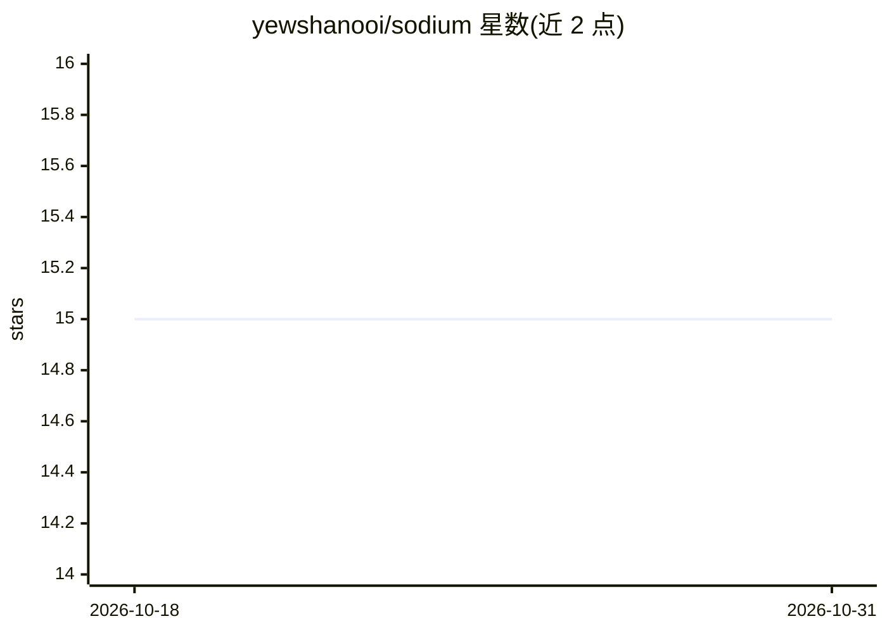

# yewshanooi/sodium

⭐ 15 · JavaScript · MIT · 推送 2026-01-30 · [GitHub](https://github.com/yewshanooi/sodium) · [官网](https://skyelements.vercel.app/sodium) · 个人维护

**多功能 Discord 机器人：含 AI 聊天、音乐、管理与趣味命令**

基于 Node.js 与 discord.js 的自托管 Discord 机器人，提供 AI 聊天（Google Gemini）、文本摘要（Hugging Face Transformers，建议 facebook/bart-large-cnn 模型）、音乐播放（Lavalink）、审核日志与排行榜（MongoDB Atlas）、趣味与工具类百余条斜杠命令。运行需 Node.js ≥22.0.0，通过 git clone 与 npm install 部署，配置 config.json 与 .env 后启动；音乐功能需另下 Lavalink.jar，摘要模型约 6.65GB（FP16）。MIT 许可。

## 筛选速览

| 维度 | 判定 | 备注 |
|---|---|---|
| AI 角色 | `ai-enhanced` | 去掉 AI 部分产品仍成立 |
| 许可风险 | `permissive` | MIT |
| 部署形态 | `library` | 以包/库形式分发 |
| 模型依赖 | — | README 未给出锁定关系 |
| 硬件要求 | — | 无带数字的原话,不猜 |
| 安装摩擦 | `low` | 无编译、无系统依赖或容器化 |
| 成熟度 | — | 结构信号不足 |

## 能力要点

- AI 聊天命令由 Google Gemini 驱动
- 文本摘要基于 Hugging Face Transformers，建议 bart-large-cnn 模型
- 音乐播放依赖 Lavalink，数据存 MongoDB Atlas
- 覆盖趣味/审核/音乐/工具四大类百余条应用命令

## 适用场景

- 给 Discord 服务器添加带 AI 聊天与摘要功能的多合一机器人
- 自助部署并管理服务器审核、排行榜与音乐播放
- 通过斜杠命令查询游戏、维基、天气等信息

## 场景标签

`聊天机器人` · 领域:对话与助手

## 证据(README 行号)

> L11: - **AI Chatbot** *(powered by Google Gemini)*
> L14: - **Text Summarizer** *(powered by Hugging Face Transformers)*

## 星数曲线

2026-10-18 15 → 2026-10-31 15（+0）

---
*卡片 v1 · prompt 1.4 · 生成 2026-10-30 · 置信度 high · 依据 README sha `080903106691` · [字段定义](../../DATASET.md)*
