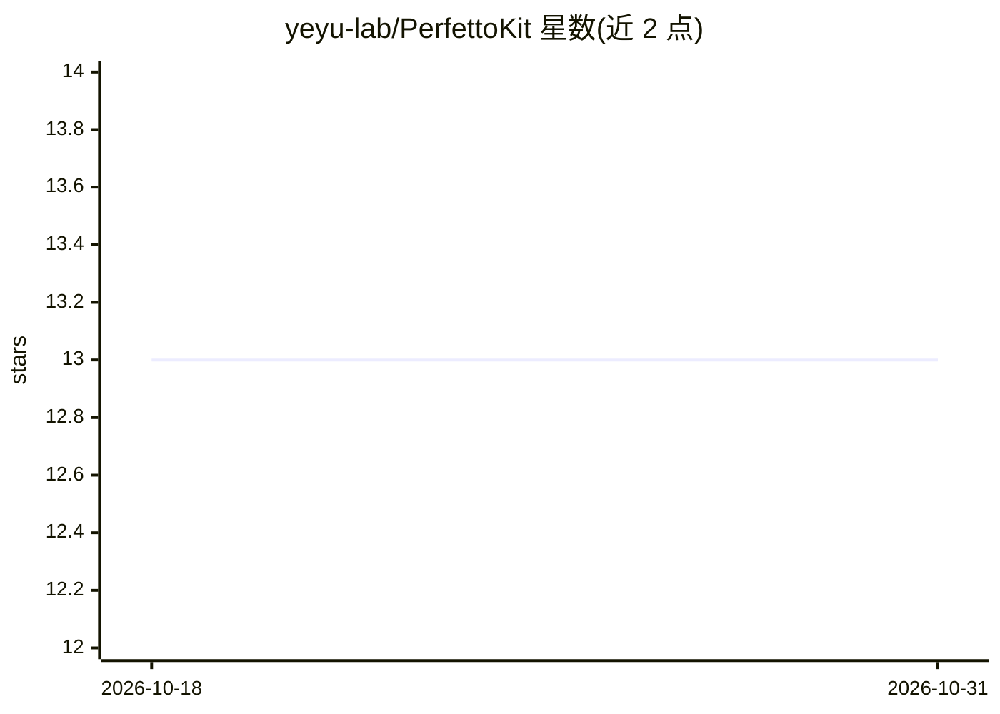

# yeyu-lab/PerfettoKit

⭐ 13 · Kotlin · Apache-2.0 · 推送 2026-07-22 · [GitHub](https://github.com/yeyu-lab/PerfettoKit) · [官网](https://github.com/yeyu-lab/PerfettoKit#readme) · 个人维护 · 中文 README

**Android 性能检测 SDK：多维采集定位卡顿并生成 AI 修复建议**

面向 Android 开发者的性能检测与根因分析 SDK（Kotlin，minSdk 24）。通过 ContentProvider 零侵入初始化，采集帧率、CPU、内存、线程、网络、IO、Bitmap 等多维数据，以 5ms 栈采样与规则引擎（5 套规则 + 10 条 YAML 卡顿模式）定位方法级卡顿元凶，输出 Logcat 分层诊断报告。AI 部分为可选增强：接入任意 OpenAI 兼容 LLM（GPT/Claude/Ollama/LM Studio/DeepSeek），自动构建结构化 prompt，输出根因、优化步骤与代码示例。经 JitPack 引入或源码集成。

## 筛选速览

| 维度 | 判定 | 备注 |
|---|---|---|
| AI 角色 | `ai-enhanced` | 去掉 AI 部分产品仍成立 |
| 许可风险 | `permissive` | Apache-2.0 |
| 部署形态 | `None` |  |
| 模型依赖 | local-ok | 支持本地模型 |
| 硬件要求 | — | 无带数字的原话,不猜 |
| 安装摩擦 | `low` | 无编译、无系统依赖或容器化 |
| 成熟度 | — | 结构信号不足 |

## 能力要点

- 多维数据采集（帧率/CPU/内存/线程/网络/IO/Bitmap/分配/Looper 慢消息）
- 方法级根因定位：5ms 栈采样 + Choreographer 慢消息抓栈 + FrameMetrics
- 规则引擎 + 可扩展 YAML 卡顿模式 Skill 库与历史回归检测
- 可选 LLM 智能诊断（OpenAI 兼容协议），输出根因/优化步骤/代码示例

## 适用场景

- 在我的 App 中定位列表滑动、布局加载等场景的卡顿元凶
- 性能迭代后自动检测指标劣化回归
- 让 LLM 基于采集数据给出可参考的修复代码

## 场景标签

 · 领域:移动开发/性能监控

## 证据(README 行号)

> L23: - **🧠 AI 智能诊断**：接入任意 OpenAI 兼容 LLM（GPT / Claude / 本地 Ollama），自动输出**根因一句话 + 优化步骤 + 代码示例**。
> L46: |`ai/`|可选的 LLM 增强（OpenAI 兼容协议）|
> L217: ## � AI 智能诊断

## 星数曲线

2026-10-18 13 → 2026-10-31 13（+0）

---
*卡片 v1 · prompt 1.4 · 生成 2026-10-31 · 置信度 high · 依据 README sha `9b0faf57475e` · [字段定义](../../DATASET.md)*
