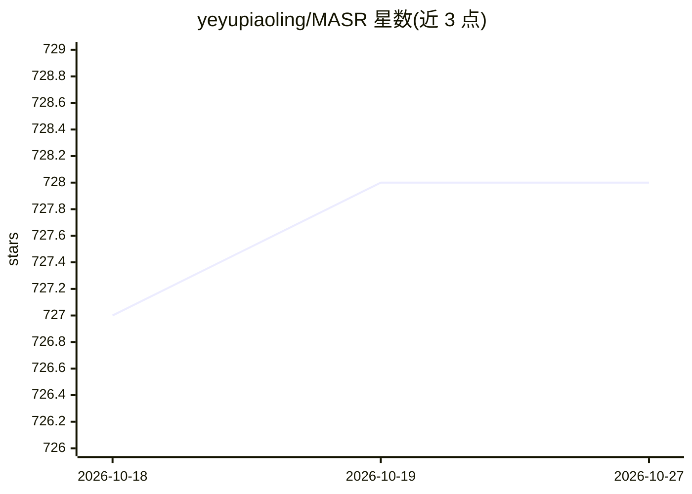

# yeyupiaoling/MASR

⭐ 728 · Python · Apache-2.0 · 推送 2026-07-06 · [GitHub](https://github.com/yeyupiaoling/MASR) · 个人维护 · 中文 README

**PyTorch 语音识别框架：流式/非流式 ASR 训练与部署**

基于 PyTorch 的自动语音识别框架（V3），支持 Conformer、Squeezeformer、DeepSpeech2、Efficient Conformer 等模型，每个模型可通过配置切换流式/非流式识别。提供 CTC 贪心、前缀束搜索、注意力重打分等多种解码器，以及 fbank/mfcc 预处理和噪声、混响、语速等多种数据增强。可部署在服务器与 Nvidia Jetson 设备，未来计划支持 Android。预训练模型（WenetSpeech/AIShell/Librispeech/粤语/中英混合/维吾尔语等）通过作者知识星球获取；提供文档教程覆盖安装、训练、评估、导出、Web 部署与 GUI 预测。

## 筛选速览

| 维度 | 判定 | 备注 |
|---|---|---|
| AI 角色 | `ai-native` | 本体是模型或模型工具 |
| 许可风险 | `permissive` | Apache-2.0 |
| 部署形态 | `None` |  |
| 模型依赖 | — | README 未给出锁定关系 |
| 硬件要求 | — | 无带数字的原话,不猜 |
| 安装摩擦 | `low` | 无编译、无系统依赖或容器化 |
| 成熟度 | — | 结构信号不足 |

## 能力要点

- 多模型支持（Conformer/Squeezeformer/DeepSpeech2/Efficient Conformer），流式与非流式可配置切换
- 多种解码器（ctc_greedy_search/ctc_prefix_beam_search/attention_rescoring/ctc_beam_search）
- 多种数据增强（噪声/混响/语速/SpecAugmentor 等）与说话人分离推理
- V3 使用 kaldi_native_fbank 预处理与 sentencepiece 制作 token，支持中英文混合训练

## 适用场景

- 训练或微调中英文、粤语、维吾尔语等语音识别模型
- 在服务器或 Jetson 设备上部署流式/非流式 ASR 服务
- 对长音频、短音频做识别并使用标点符号模型后处理

## 场景标签

`语音识别` `模型训练` · 领域:感知与多模态

## 证据(README 行号)

> L9: MASR是一款基于Pytorch实现的自动语音识别框架，MASR全称是神奇的自动语音识别框架（Magical Automatic Speech Recognition），当前为V3版本，与V2版本不兼容，如果想使用V2版本，请在这个
> L31: 1. 支持多个语音识别模型，包含`deepspeech2`、`conformer`、`squeezeformer`、`efficient_conformer`等，每个模型都支持流式识别和非流式识别，在配置文件中`streaming

## 星数曲线

2026-10-18 727 → 2026-10-27 728（+1）

---
*卡片 v1 · prompt 1.4 · 生成 2026-10-21 · 置信度 high · 依据 README sha `4f549aa393a9` · [字段定义](../../DATASET.md)*
