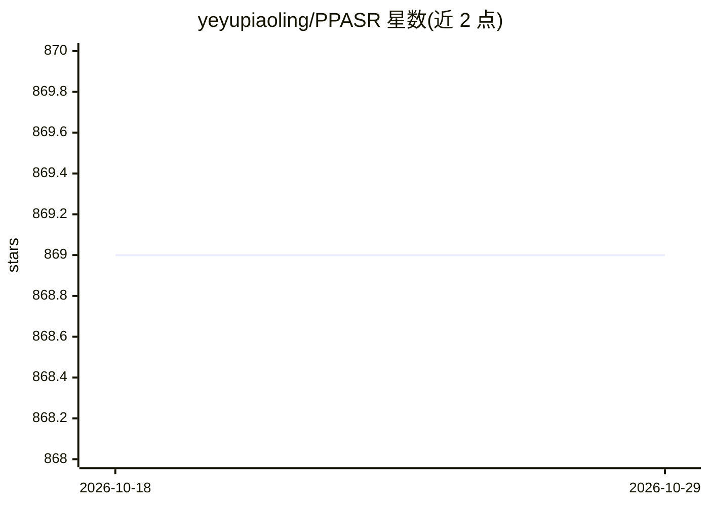

# yeyupiaoling/PPASR

⭐ 869 · Python · Apache-2.0 · 推送 2025-12-17 · [GitHub](https://github.com/yeyupiaoling/PPASR) · 个人维护 · 中文 README

**基于 PaddlePaddle 的中文语音识别训练与部署框架**

PPASR 是基于 PaddlePaddle 实现的自动语音识别框架（V3 版本，与 V2 不兼容），支持 DeepSpeech2、Conformer、Squeezeformer、Efficient Conformer 等模型，每个模型均可通过配置切换流式/非流式识别。提供多种解码器（CTC 贪心、前缀束搜索、注意力重打分等）、预处理（fbank/mfcc）与数据增强方法，支持短音频、长音频、流式及说话人分离推理。预训练模型覆盖 WenetSpeech、AIShell、Librispeech 及粤语、中英混合、维吾尔语等数据集，模型文件通过知识星球分发。可部署于服务器与 Nvidia Jetson 设备。

## 筛选速览

| 维度 | 判定 | 备注 |
|---|---|---|
| AI 角色 | `ai-native` | 本体是模型或模型工具 |
| 许可风险 | `permissive` | Apache-2.0 |
| 部署形态 | `None` |  |
| 模型依赖 | — | README 未给出锁定关系 |
| 硬件要求 | — | 无带数字的原话,不猜 |
| 安装摩擦 | `low` | 无编译、无系统依赖或容器化 |
| 成熟度 | — | 结构信号不足 |

## 能力要点

- 支持 deepspeech2/conformer/squeezeformer/efficient_conformer，均可切换流式与非流式
- 多种解码器与数据增强方法
- 覆盖普通话、英语、粤语、中英混合、维吾尔语等多语言预训练模型
- 支持说话人分离推理与 Web/GUI 部署

## 适用场景

- 训练自己的中文或中英混合语音识别模型
- 部署流式/非流式语音识别服务
- 用预训练模型做长音频转写或说话人分离识别

## 场景标签

`语音识别` · 领域:感知与多模态

## 证据(README 行号)

> L9: PPASR是一款基于PaddlePaddle实现的自动语音识别框架，PPASR中文名称PaddlePaddle中文语音识别（PaddlePaddle Automatic Speech Recognition），当前为V3版本，与V2
> L31: 1. 支持多个语音识别模型，包含`deepspeech2`、`conformer`、`squeezeformer`、`efficient_conformer`等，每个模型都支持流式识别和非流式识别，在配置文件中`streaming

## 星数曲线

2026-10-18 869 → 2026-10-29 869（+0）

---
*卡片 v1 · prompt 1.4 · 生成 2026-10-21 · 置信度 high · 依据 README sha `6fc3514114a8` · [字段定义](../../DATASET.md)*
