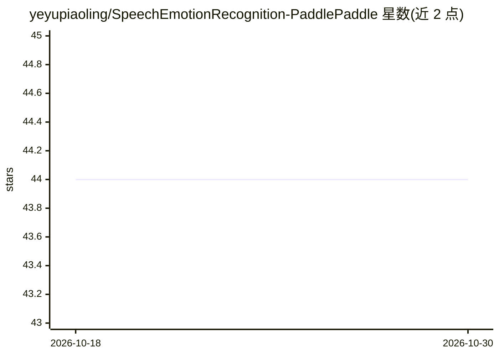

# yeyupiaoling/SpeechEmotionRecognition-PaddlePaddle

⭐ 44 · Python · Apache-2.0 · 推送 2025-12-17 · [GitHub](https://github.com/yeyupiaoling/SpeechEmotionRecognition-PaddlePaddle) · 个人维护 · 中文 README

**基于 PaddlePaddle 的语音情感识别训练项目，供学习使用**

个人维护的语音情感识别项目：基于 PaddlePaddle 框架，默认使用 RAVDESS 数据集（八类情感）训练 BidirectionalLSTM 等模型，流程覆盖生成数据列表、可选预提取特征、单卡/多卡训练、评估（输出准确率与混淆矩阵）及对单条音频的预测推断。作者自述目前效果一般，模型文件需加入知识星球获取。依赖 ppser 库，建议源码安装。

## 筛选速览

| 维度 | 判定 | 备注 |
|---|---|---|
| AI 角色 | `ai-native` | 本体是模型或模型工具 |
| 许可风险 | `permissive` | Apache-2.0 |
| 部署形态 | `library` | 以包/库形式分发 |
| 模型依赖 | — | README 未给出锁定关系 |
| 硬件要求 | — | 无带数字的原话,不猜 |
| 安装摩擦 | `low` | 无编译、无系统依赖或容器化 |
| 成熟度 | `idea` | |

## 能力要点

- 支持 RAVDESS 八类情感数据的训练与自定义数据集接入
- 提供特征预提取、训练、评估（准确率/混淆矩阵）、预测完整流程
- 支持 PaddlePaddle 单卡与多卡分布式训练
- 模型在 RAVDESS 上准确率 0.95193（作者自报）

## 适用场景

- 学习基于 PaddlePaddle 的语音情感识别实现
- 用自己的音频数据集训练情感分类模型
- 对单条音频做情感类别预测

## 场景标签

`教程课程` `模型训练` · 领域:学习与行业

## 证据(README 行号)

> L1: # 基于PaddlePaddle实现的语音情感识别系统
> L3: 本项目是一个语音情感识别项目，目前效果一般，供大家学习使用。后面会持续优化，提高准确率，如果同学们有好的建议，也欢迎来探讨。
> L142: 在训练结束之后，我们得到了一个模型参数文件，我们使用这个模型预测音频。

## 星数曲线

2026-10-18 44 → 2026-10-30 44（+0）

---
*卡片 v1 · prompt 1.4 · 生成 2026-10-25 · 置信度 mid · 依据 README sha `1e00132647bf` · [字段定义](../../DATASET.md)*
