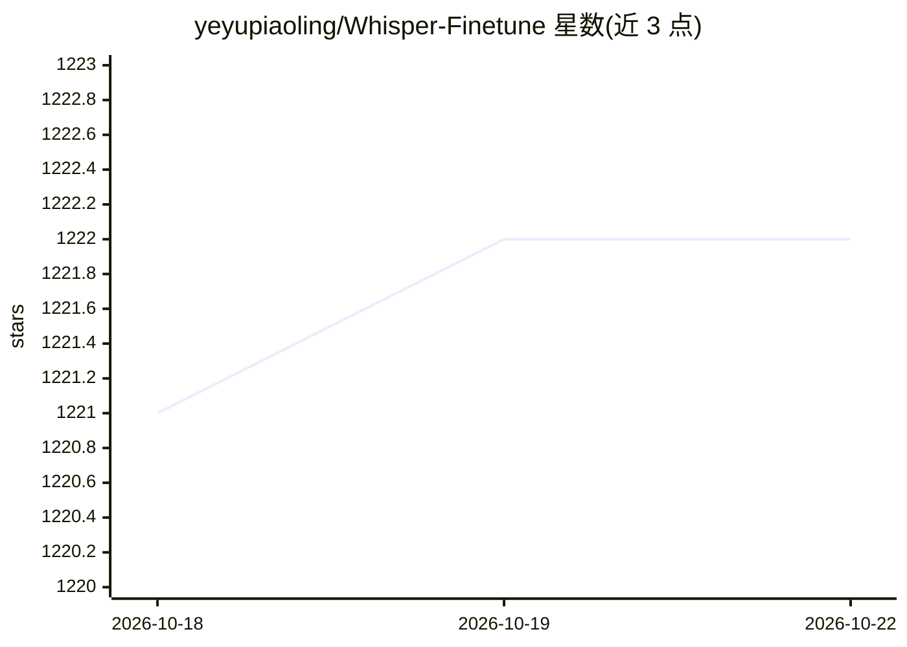

# yeyupiaoling/Whisper-Finetune

⭐ 1,222 · C · Apache-2.0 · 推送 2026-05-08 · [GitHub](https://github.com/yeyupiaoling/Whisper-Finetune) · 个人维护 · 中文 README

**Whisper 语音识别模型 Lora 微调与多端部署工具集**

对 OpenAI Whisper 系列模型（tiny 至 large-v3-turbo）使用 Lora 进行微调，支持无时间戳数据、有时间戳数据、无语音数据三种训练方式，并提供数据准备（aishell.py 自动下载生成 AIShell 训练集）、模型合并、字错率/词错率评估流程。推理侧支持 PyTorch 编译器、FlashAttention2、BetterTransformer 加速，以及 CTranslate2、GGML 格式转换，可部署为 Web 服务（/recognition 接口）、Windows 桌面应用与 Android 应用。面向语音识别开发者，README 附多组字错率与推理速度测试表；训练使用环境为 Ubuntu + A100 GPU。

## 筛选速览

| 维度 | 判定 | 备注 |
|---|---|---|
| AI 角色 | `ai-ecosystem` | LLM/agent 周边工具 |
| 许可风险 | `permissive` | Apache-2.0 |
| 部署形态 | `library` | 以包/库形式分发 |
| 模型依赖 | — | README 未给出锁定关系 |
| 硬件要求 | — | 无带数字的原话,不猜 |
| 安装摩擦 | `medium` | 含编译或系统依赖之一 |
| 成熟度 | — | 结构信号不足 |

## 能力要点

- Lora 微调 Whisper，支持无时间戳/有时间戳/无语音三种数据训练
- 合并、评估（CER/WER）、推理完整流程脚本
- CTranslate2 与 GGML 格式转换加速推理
- 支持 Web 服务部署（/recognition 接口）、Windows 桌面与 Android 部署

## 适用场景

- 用中文或方言数据集微调 Whisper 降低字错率
- 将微调后的模型部署为语音识别 Web API
- 在 Android 或 Windows 桌面端离线运行转换后的模型

## 场景标签

 · 领域:语音识别/模型训练

## 证据(README 行号)

> L13: OpenAI在开源了号称其英文语音辨识能力已达到人类水准的Whisper项目，且它亦支持其它98种语言的自动语音辨识。Whisper所提供的自动语音识与翻译任务，它们能将各种语言的语音变成文本，也能将这些文本翻译成英文。本项目主要
> L55: 2. `finetune.py`：微调模型。

## 星数曲线

2026-10-18 1,221 → 2026-10-22 1,222（+1）

---
*卡片 v1 · prompt 1.4 · 生成 2026-10-21 · 置信度 high · 依据 README sha `6e5891fd9a96` · [字段定义](../../DATASET.md)*
