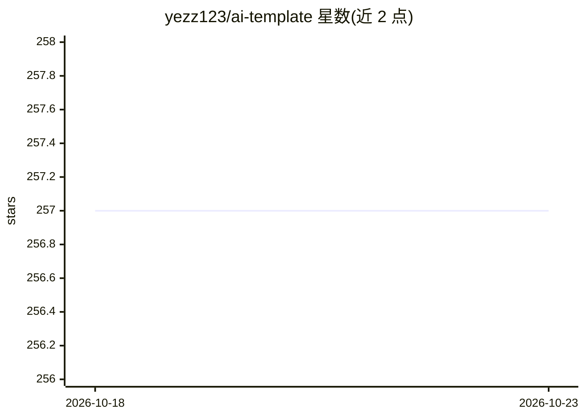

# yezz123/ai-template

⭐ 257 · Python · MIT · 推送 2026-10-01 · [GitHub](https://github.com/yezz123/ai-template) · 个人维护

**多租户 SaaS 模板：FastAPI+authx+Next.js，AI 功能可选**

基于 FastAPI、authx、SQLAlchemy 与 Next.js 16 的多租户 SaaS 脚手架：提供组织/工作区数据隔离、Owner/Admin/Member 角色映射 authx scopes（含通配符）、按 org 签发的 JWT、每组织 API key、邮件邀请。可选模块由 FEATURE_* 环境变量开关，包括 OAuth（Google/GitHub）、magic-link、Resend/SMTP 邮件、Stripe 订阅、Pydantic AI + LLM Gateway（聊天与 agent 模板、golden-transcript 评测）、Logfire 可观测性与审计日志。Docker Compose 一键运行，含 Nginx 网关、健康探针与迁移流程；面向构建 SaaS 的开发者。

## 筛选速览

| 维度 | 判定 | 备注 |
|---|---|---|
| AI 角色 | `ai-enhanced` | 去掉 AI 部分产品仍成立 |
| 许可风险 | `permissive` | MIT |
| 部署形态 | `self-host` | docker 或自建部署 |
| 模型依赖 | — | README 未给出锁定关系 |
| 硬件要求 | — | 无带数字的原话,不猜 |
| 安装摩擦 | `low` | 无编译、无系统依赖或容器化 |
| 成熟度 | — | 结构信号不足 |

## 能力要点

- 共享库共享 schema 的多租户模型，org_id 贯穿所有仓储函数
- 全部可选模块经 FEATURE_* 环境变量开关，关闭时零运行时开销
- Docker Compose + Make 全栈启动，含 Nginx 网关与健康/就绪探针
- 可选 Pydantic AI + LLM Gateway：聊天、demo agent 与生产 agent 模板及 golden-transcript 评测

## 适用场景

- 快速搭建带多租户与权限体系的生产级 SaaS
- 需要 Stripe 订阅、OAuth、审计日志等可开关功能的团队
- 在 SaaS 中加入 AI 聊天与 agent 能力的项目

## 场景标签

 · 领域:Web 开发/SaaS 脚手架

## 证据(README 行号)

> L3: > Multi-tenant SaaS boilerplate built on FastAPI + authx + Next.js. Every feature toggleable via env vars; ship a pr
> L24: - Optional, all gated by `FEATURE_*` env vars: OAuth (Google/GitHub), magic-link, real email delivery (Resend/SMTP)
> L142: |`FEATURE_AI_CHAT`|`false`|Pydantic AI + LLM Gateway|

## 星数曲线

2026-10-18 257 → 2026-10-23 257（+0）

---
*卡片 v1 · prompt 1.4 · 生成 2026-10-22 · 置信度 high · 依据 README sha `c5f7ff4e1250` · [字段定义](../../DATASET.md)*
