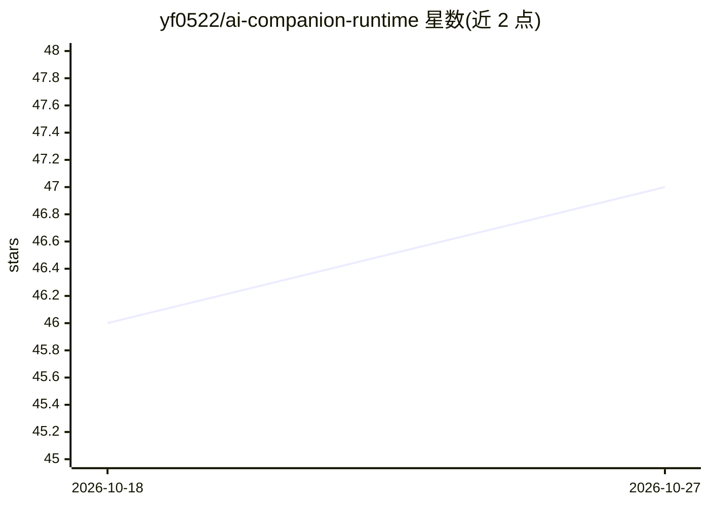

# yf0522/ai-companion-runtime

⭐ 47 · Python · MIT · 推送 2026-10-16 · [GitHub](https://github.com/yf0522/ai-companion-runtime) · 个人维护 · 中文 README

**老龄照护场景的实时 AI 陪伴运行时，含风险分级与家属通知**

面向老龄照护的 AI 陪伴软件运行时：基于 WebSocket 流式对话，提供风险识别（健康紧急/诈骗/情绪低落，4 级响应）、提醒任务生命周期、五层长期记忆、动态人格与全链路 Trace 观测。后端 FastAPI + PostgreSQL/pgvector + Redis，前端 Next.js 14，模型经 OpenAI 兼容 Adapter 支持 Qwen/DeepSeek/OpenAI/Gemini/本地模型并可热插拔，Docker Compose 部署。README 明确区分已实现项与 roadmap（语音克隆、手机拦截、ESP32 闭环硬件未声称完成），家属通知 provider 目前为 sandbox/未配置。

## 筛选速览

| 维度 | 判定 | 备注 |
|---|---|---|
| AI 角色 | `ai-native` | 本体是模型或模型工具 |
| 许可风险 | `permissive` | MIT |
| 部署形态 | `self-host` | docker 或自建部署 |
| 模型依赖 | — | README 未给出锁定关系 |
| 硬件要求 | — | 无带数字的原话,不猜 |
| 安装摩擦 | `low` | 无编译、无系统依赖或容器化 |
| 成熟度 | `idea` | |

## 能力要点

- WebSocket 流式对话 + 风险分级（关键词/正则，无模型调用，<2ms）
- CareTask 生命周期与 Reminder 设备投递/回执
- 五层 Memory 架构（L0-L4），向量检索仍为 roadmap
- 模型热插拔：OpenAI 兼容 Adapter 覆盖 Qwen/DeepSeek/OpenAI/本地模型
- 全链路 Trace：trace_id、前端瀑布图、TTFT/成本统计

## 适用场景

- 为独居老人提供带风险拦截的日常对话陪伴与用药提醒
- 家属通过通知与每日摘要了解老人状态与风险线索
- 作为照护设备的软件运行时，接入设备端实时语音路由

## 场景标签

`聊天机器人` `Agent 记忆` · 领域:Agent 开发

## 证据(README 行号)

> L3: 面向老龄照护场景的实时 AI 陪伴 + 风险分级运行时。基于 WebSocket 的流式对话，支持风险识别（健康紧急/诈骗识别/情绪低落）、工具调用、长期记忆、模型热插拔与全链路 Trace 观测。
> L17: |Risk detection|已对接老龄场景类别：`health_emergency`、`scam_alert`、`emotional_low`；关键字/正则 + 否定词 + 安全上下文已由测试覆盖。|
> L24: |Family notification and cases|Contract primitives implemented: versioned safety decisions, atomic notification out

## 星数曲线

2026-10-18 46 → 2026-10-27 47（+1）

---
*卡片 v1 · prompt 1.4 · 生成 2026-10-25 · 置信度 high · 依据 README sha `1f2a212dc467` · [字段定义](../../DATASET.md)*
