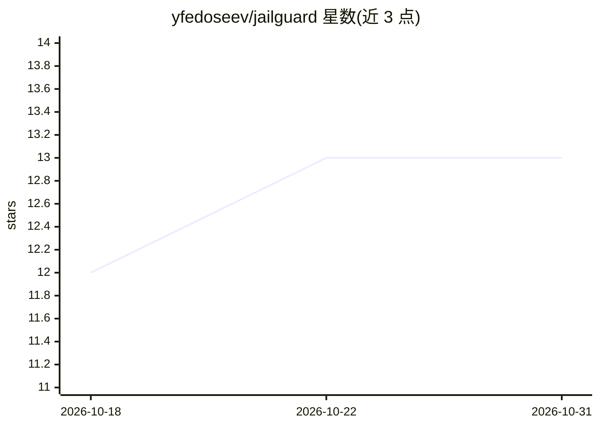

# yfedoseev/jailguard

⭐ 13 · Rust · Apache-2.0 · 推送 2026-08-13 · [GitHub](https://github.com/yfedoseev/jailguard) · [官网](https://docs.rs/jailguard) · 个人维护

**纯 Rust 提示注入检测库：嵌入 1.5MB MLP 分类器，CPU 上 14ms 判定**

面向 LLM 安全开发者的提示注入检测库：用冻结的 MiniLM-L6-v2 ONNX 嵌入器生成 384 维语义向量，再由编译期嵌入的 1.5MB 三层 MLP（约 13 万参数）输出注入/良性判定，训练数据覆盖直接注入、越狱、编码攻击、间接注入等 8 类攻击家族。无外部服务与 API key，90MB 嵌入模型首次使用时自动下载缓存。提供 Rust、Python、JavaScript、Go、Elixir 五种语言绑定，多数平台预编译无需 Rust 工具链。在 Apple M3 上报告 p50 约 14ms 单线程延迟，held-out 测试集准确率 98.40%（OOD 难例集降至 89.12%）。README 含与 Lakera Guard、Rebuff 等的对比表。

## 筛选速览

| 维度 | 判定 | 备注 |
|---|---|---|
| AI 角色 | `ai-ecosystem` | LLM/agent 周边工具 |
| 许可风险 | `permissive` | Apache-2.0 |
| 部署形态 | `library` | 以包/库形式分发 |
| 模型依赖 | — | README 未给出锁定关系 |
| 硬件要求 | — | 无带数字的原话,不猜 |
| 安装摩擦 | `medium` | 含编译或系统依赖之一 |
| 成熟度 | — | 结构信号不足 |

## 能力要点

- MiniLM 嵌入 + 1.5MB MLP 的两段式检测管线，无需外部服务与 API key
- Rust、Python、JavaScript、Go、Elixir 五种语言绑定，多平台预编译产物
- 训练覆盖 8 类攻击家族（直接注入、越狱、编码攻击、间接注入等）
- 提供 Criterion 基准、冷启动测量与可复现的基准脚本

## 适用场景

- 在 LLM 应用入口拦截提示注入与越狱输入
- 多语言技术栈中嵌入本地提示注入检测
- 低配置或无 GPU 的 CPU 环境下做低延迟安全过滤

## 场景标签

`网络安全` · 领域:学习与行业

## 证据(README 行号)

> L11: > **JailGuard is a pure-Rust prompt-injection detector with a 1.5 MB embedded MLP classifier.** It scores text in *
> L67: |Feature|JailGuard|Lakera Guard|Rebuff|ProtectAI deberta-v3|Meta Prompt Guard 2|

## 星数曲线

2026-10-18 12 → 2026-10-31 13（+1）

---
*卡片 v1 · prompt 1.4 · 生成 2026-10-31 · 置信度 high · 依据 README sha `0f41590b0d86` · [字段定义](../../DATASET.md)*
