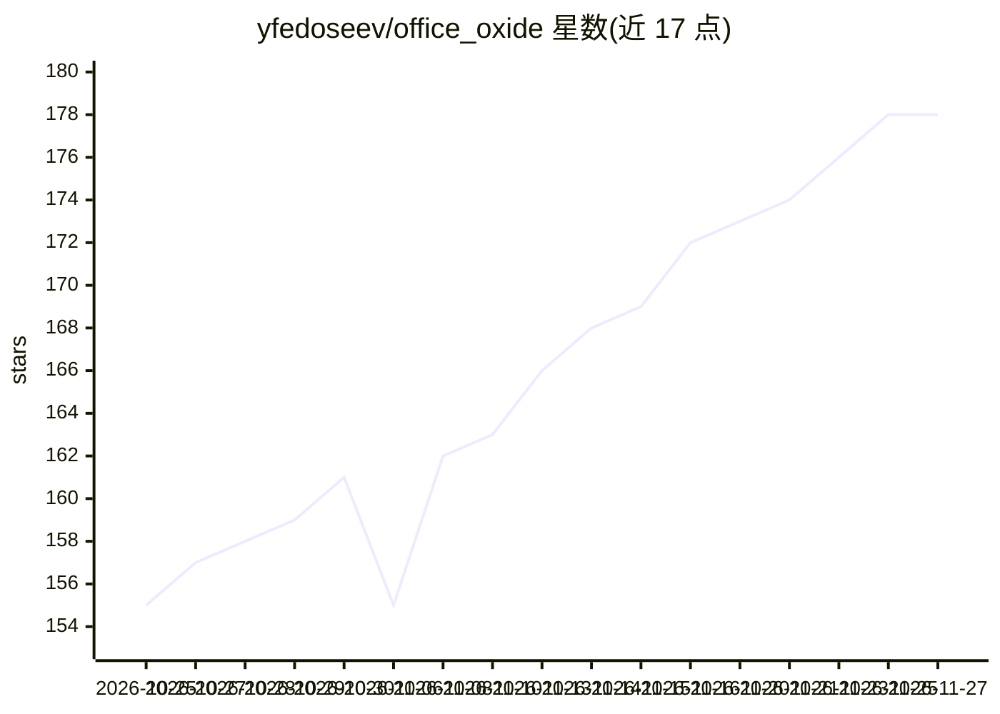

# yfedoseev/office_oxide

⭐ 178 · Rust · Apache-2.0 · 推送 2026-11-25 · [GitHub](https://github.com/yfedoseev/office_oxide) · [官网](https://office.oxide.fyi) · 个人维护

**多语言 Office 文档文本提取库：DOCX/XLSX/PPTX 及旧格式读取转换**

以 Rust 为核心的 Office 文档处理库，提供 Python、Go、C#/.NET、Node.js（原生与 WASM）、C FFI 绑定及 CLI。支持 DOCX、XLSX、PPTX 的读取/写入/编辑，旧格式 DOC/XLS/PPT 可读取并转换为对应 OOXML 格式；输出纯文本、Markdown、HTML 与格式无关的中间表示。内置 8 项资源上限（条目数、解压比、内存等）用于处理不可信输入，命中上限仍返回结果并在警告中报告被裁剪内容。通过 crates.io、PyPI、npm、NuGet、go get 与 cargo install 分发。

## 筛选速览

| 维度 | 判定 | 备注 |
|---|---|---|
| AI 角色 | `ai-enhanced` | 去掉 AI 部分产品仍成立 |
| 许可风险 | `permissive` | Apache-2.0 |
| 部署形态 | `library` | 以包/库形式分发 |
| 模型依赖 | — | README 未给出锁定关系 |
| 硬件要求 | — | 无带数字的原话,不猜 |
| 安装摩擦 | `high` | 编译与系统依赖俱全 |
| 成熟度 | — | 结构信号不足 |

## 能力要点

- 6 种格式（DOCX/XLSX/PPTX/DOC/XLS/PPT）读取，旧格式可转换为 OOXML
- Rust 内核 + Python/Go/C#/Node.js/WASM/C FFI 多语言绑定
- 文本、Markdown、HTML 及格式无关中间表示（IR）输出
- 内置 8 项不可信输入资源上限与 damage() 损坏报告机制

## 适用场景

- 批量从 Office 文档中提取文本做数据处理
- 把旧版 DOC/XLS/PPT 批量转换为 OOXML 格式
- 将 Office 文档转成 Markdown/HTML 供下游流程使用
- 处理来源不可信的 Office 文件时按资源上限控制内存

## 场景标签

`文档解析` `RAG` · 领域:知识与检索

## 证据(README 行号)

> L3: A fast, memory-safe library for text extraction from Office documents. Rust core with **first-class bindings for Pyt
> L35: |MCP server|`office-oxide-mcp` binary|`crates/office_oxide_mcp/`||

## 星数曲线

2026-10-25 155 → 2026-11-27 178（+23）

---
*卡片 v1 · prompt 1.4 · 生成 2026-11-26 · 置信度 high · 依据 README sha `36b74f9232cc` · [字段定义](../../DATASET.md)*
