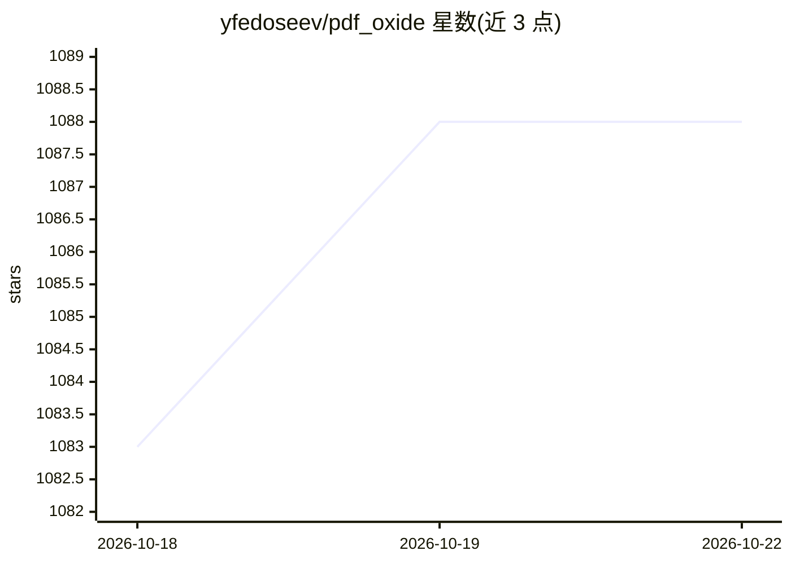

# yfedoseev/pdf_oxide

⭐ 1,089 · Rust · Apache-2.0 · 推送 2026-10-20 · [GitHub](https://github.com/yfedoseev/pdf_oxide) · [官网](https://oxide.fyi) · 个人维护

**面向 20 种语言的 PDF 处理库：提取、转换与编辑，附 CLI 与 MCP**

以 Rust 核心为基础的 PDF 工具库，提供文本/图像提取、Markdown/HTML 转换、PDF 创建与编辑、表单字段读写等功能，通过 C ABI 封装为 Python、Go、JS/TS、C#、Java 等 19 种语言绑定，另有 22 条命令的 CLI 工具。附带 MCP server，使 Claude、Cursor 等 AI 助手可在本地读取 PDF 内容。提供 pip、cargo、npm、brew 等安装途径，Linux/macOS/Windows 均有预编译产物。基准测试在 3,830 个 PDF 上报告 0.8ms 均值提取耗时；仅做文本提取，不含 OCR。

## 筛选速览

| 维度 | 判定 | 备注 |
|---|---|---|
| AI 角色 | `ai-enhanced` | 去掉 AI 部分产品仍成立 |
| 许可风险 | `permissive` | Apache-2.0 |
| 部署形态 | `library` | 以包/库形式分发 |
| 模型依赖 | — | README 未给出锁定关系 |
| 硬件要求 | — | 无带数字的原话,不猜 |
| 安装摩擦 | `high` | 编译与系统依赖俱全 |
| 成熟度 | — | 结构信号不足 |

## 能力要点

- Rust 核心 + 19 种语言绑定共享同一实现
- 文本/图像提取、Markdown 转换、PDF 创建与编辑
- 22 条命令的 CLI（含 REPL 模式）
- MCP server 供 AI 助手本地读取 PDF

## 适用场景

- 把 PDF 批量转为 Markdown 供 RAG / LLM 流水线使用
- 让 Claude、Cursor 等 MCP 客户端直接读取本地 PDF
- 提取表单、表格与版面结构化数据
- 程序化生成发票、报告等 PDF 文档

## 场景标签

 · 领域:文档处理/PDF 库

## 证据(README 行号)

> L5: The fastest PDF library for text extraction, image extraction, and markdown conversion. A Rust core with bindings fo
> L282: `pdf-oxide-mcp` lets AI assistants (Claude, Cursor, etc.) extract content from PDFs locally via the Model Context 

## 星数曲线

2026-10-18 1,083 → 2026-10-22 1,088（+5）

---
*卡片 v1 · prompt 1.4 · 生成 2026-10-21 · 置信度 high · 依据 README sha `d41f189e88ce` · [字段定义](../../DATASET.md)*
