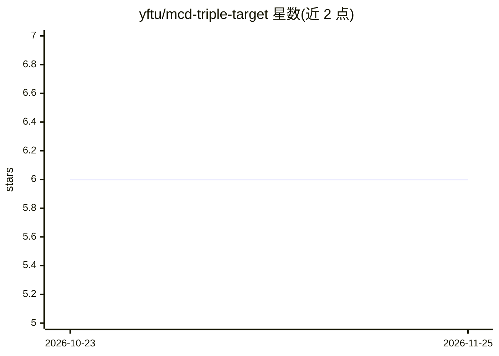

# yftu/mcd-triple-target

⭐ 6 · Python · NOASSERTION · 推送 2026-10-10 · [GitHub](https://github.com/yftu/mcd-triple-target) · 个人维护 · 中文 README

**基于麦当劳官方 MCP 的三目标配餐优化 Skill**

作为可被 Agent 加载的 Skill 运行：读取麦当劳官方 MCP 的 160 条结构化营养数据，对热量、蛋白质、预算三目标做加权寻优，输出配餐方案与达标率，并支持忌口过滤与门店实时菜单查询。核心工程包括四层 MCP 响应解包与 toon 表格解析，160 条数据实测全部解析成功。核心脚本仅用 Python 标准库，需自备麦当劳 MCP Token；下单链路默认不自动执行。适合减脂/增肌人群和 MCP 开发者复用解析层。

## 筛选速览

| 维度 | 判定 | 备注 |
|---|---|---|
| AI 角色 | `ai-native` | 本体是模型或模型工具 |
| 许可风险 | `none` | NOASSERTION |
| 部署形态 | `None` |  |
| 模型依赖 | — | README 未给出锁定关系 |
| 硬件要求 | — | 无带数字的原话,不猜 |
| 安装摩擦 | `low` | 无编译、无系统依赖或容器化 |
| 成熟度 | — | 结构信号不足 |

## 能力要点

- 热量/蛋白质/预算三目标加权寻优，输出达标率
- 四层嵌套 MCP 响应解包与 toon 表格解析（160/160 成功）
- 基于 Mifflin-St Jeor 公式的热量预算与蛋白目标模型
- 零第三方依赖，核心脚本仅用 Python 标准库

## 适用场景

- 减脂期在预算内让 AI 帮我配低热量高蛋白的麦当劳餐
- 增肌期从 160 个餐品中系统筛选高蛋白选项
- 忌口（辣/牛肉/海鲜）时快速筛出可选餐品
- 复用解析层和优化引擎做麦当劳 MCP 二次开发

## 场景标签

 · 领域:生活服务/AI 应用

## 证据(README 行号)

> L7: 基于麦当劳官方 MCP 实时数据 · 热量 / 蛋白质 / 预算三目标配餐优化
> L40: |在减脂 / 增肌期，但不想自己算|说人话就能拿到配餐方案 + 达标率|
> L249: ├── SKILL.md                      # Skill 主文件（Agent 直接读取）

## 星数曲线

2026-10-23 6 → 2026-11-25 6（+0）

---
*卡片 v1 · prompt 1.4 · 生成 2026-11-20 · 置信度 high · 依据 README sha `b82a0b01fc15` · [字段定义](../../DATASET.md)*
