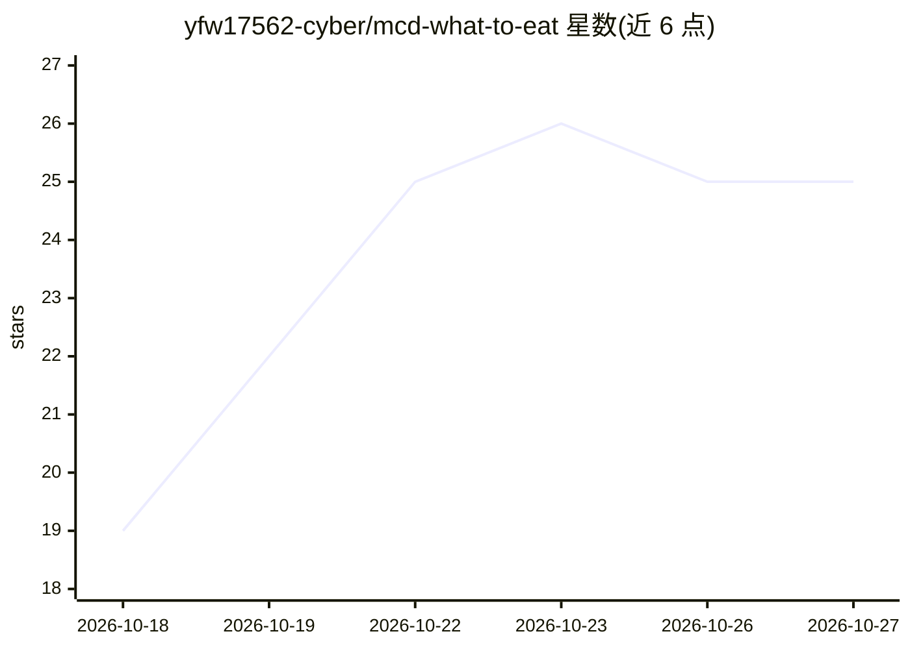

# yfw17562-cyber/mcd-what-to-eat

⭐ 25 · Python · 推送 2026-10-14 · [GitHub](https://github.com/yfw17562-cyber/mcd-what-to-eat) · 个人维护 · 中文 README

**抽运势签并搭配麦当劳套餐的 MCP Skill（黑客松作品）**

面向麦当劳爱好者的娱乐点餐 Skill：先以 SHA256(日期+签主+重抽序号) 种子生成六级签等的今日运势（签诗、宜忌、幸运数字），再从麦当劳中国官方 MCP 拉取指定门店实时菜单随机搭配套餐，价格热量来自官方营养表，多命中时输出热量区间。可安装为 WorkBuddy Skill 由 Agent 触发，也可命令行直接运行生成交互式像素风 HTML 单文件；无 Token 或断网时降级到内置参考菜单。仅调用 4 个只读 MCP 工具，不执行下单等写操作。

## 筛选速览

| 维度 | 判定 | 备注 |
|---|---|---|
| AI 角色 | `ai-native` | 本体是模型或模型工具 |
| 许可风险 | `none` | — |
| 部署形态 | `None` |  |
| 模型依赖 | — | README 未给出锁定关系 |
| 硬件要求 | — | 无带数字的原话,不猜 |
| 安装摩擦 | `low` | 无编译、无系统依赖或容器化 |
| 成熟度 | — | 结构信号不足 |

## 能力要点

- 种子化确定性抽签：同一天同一签主结果固定
- 门店/价格/热量来自麦当劳官方 MCP 实时数据，热量多命中输出区间
- 零依赖单文件 HTML 交付，星露谷像素风内联 SVG 界面
- 无 Token 时优雅降级到内置参考菜单

## 适用场景

- 选择困难时一句话获得带抽签仪式感的麦当劳套餐推荐
- 在 WorkBuddy 等 MCP 客户端中作为点餐娱乐 Skill 使用
- MCP/Skill 开发者参考商业 MCP 数据应用的落地实现

## 场景标签

 · 领域:生活娱乐/MCP 应用

## 证据(README 行号)

> L5: 一个基于**麦当劳中国官方 MCP** 开发的 Skill：把「今天吃什么」这个世纪难题，变成一次有仪式感的抽签——先摇今日运势，再随机搭配一整套麦当劳套餐。价格、热量、商品图全部来自官方实时数据。
> L46: cp -r skill ~/.workbuddy/skills/mcd-what-to-eat

## 星数曲线

2026-10-18 19 → 2026-10-27 25（+6）

---
*卡片 v1 · prompt 1.4 · 生成 2026-10-26 · 置信度 high · 依据 README sha `3fba0919217b` · [字段定义](../../DATASET.md)*
