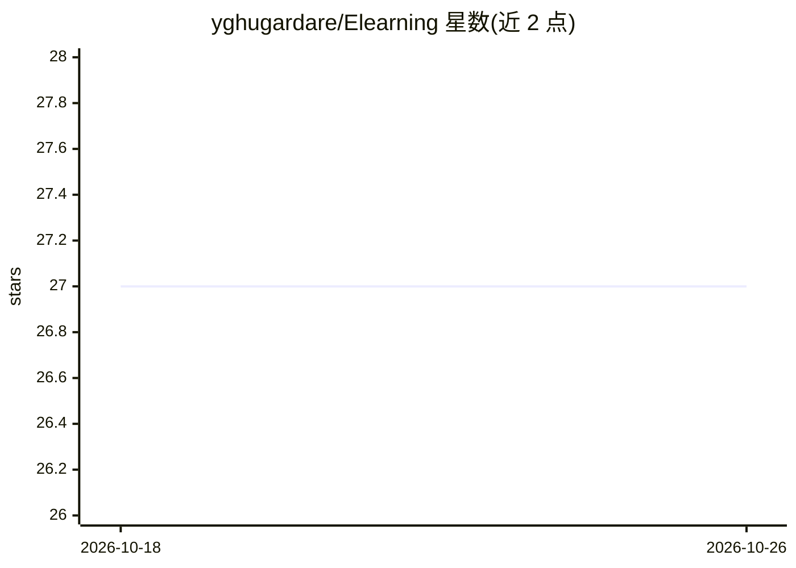

# yghugardare/Elearning

⭐ 27 · TypeScript · 推送 2026-09-24 · [GitHub](https://github.com/yghugardare/Elearning) · [官网](https://elearning-front-end.vercel.app/) · 个人维护

**全栈在线课程平台：教师售课，AI 助手基于课程转录答疑**

基于 Next.js 14 + Express + MongoDB 的全栈电商式学习平台：教师上传课程视频，学生购买后观看，平台提供实时订单/课程/用户分析仪表盘、即时通知、Stripe 支付与 VdoCipher DRM 视频保护。AI 部分为 ASKAI 答疑助手：视频经 FFMPEG 转音频、AssemblyAI 转录后，接 Google Generative AI（Gemini）按课程内容回答学生疑问；另有学生 Q&A 论坛。转录服务用 Streamlit + Docker 单独交付。

## 筛选速览

| 维度 | 判定 | 备注 |
|---|---|---|
| AI 角色 | `ai-enhanced` | 去掉 AI 部分产品仍成立 |
| 许可风险 | `none` | — |
| 部署形态 | `library` | 以包/库形式分发 |
| 模型依赖 | — | README 未给出锁定关系 |
| 硬件要求 | — | 无带数字的原话,不猜 |
| 安装摩擦 | `low` | 无编译、无系统依赖或容器化 |
| 成熟度 | — | 结构信号不足 |

## 能力要点

- 视频→音频→转录→AI 问答的流水线（AssemblyAI + Gemini）
- 管理端实时分析仪表盘（Recharts）与即时通知（socket.io）
- VdoCipher DRM 视频保护与 Stripe 支付
- 课程问答论坛与 AI 助手双通道答疑

## 适用场景

- 教师上传课程视频并获得基于课程内容的 AI 答疑
- 学生购买课程并通过 AI 助手或论坛提问
- 讲师通过仪表盘跟踪销售与学生情况

## 场景标签

 · 领域:在线教育/Web 应用

## 证据(README 行号)

> L3: This full-stack E-learning website allows tutors to upload courses and students to purchase them. Students can get d
> L63: - **@google/generative-ai:** Integration with Google's Generative AI LLM for AI assistance.

## 星数曲线

2026-10-18 27 → 2026-10-26 27（+0）

---
*卡片 v1 · prompt 1.4 · 生成 2026-10-26 · 置信度 high · 依据 README sha `7802e1ba0fe2` · [字段定义](../../DATASET.md)*
