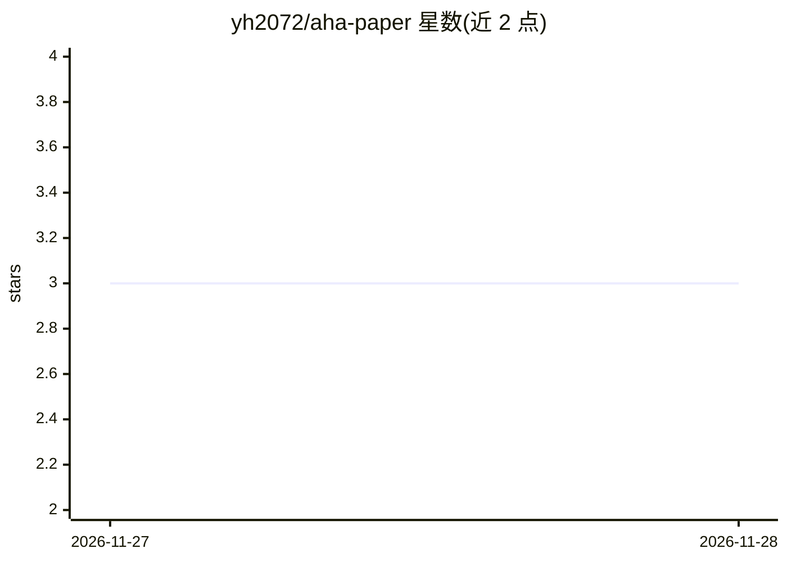

# yh2072/aha-paper

⭐ 3 · Python · Apache-2.0 · 推送 2026-11-24 · [GitHub](https://github.com/yh2072/aha-paper) · [官网](https://aha-paper.vercel.app) · 个人维护 · 中文 README

**把论文 PDF 变成带原文定位标注的自动讲解导览**

输入一篇 PDF 论文，生成多章节的旁白讲解：文本转语音朗读内容，同时在论文原页面与图上高亮当前正在解释的句子或图版。模型只回答'这行旁白对应原文哪个句子'，坐标由 PDF 文本层计算得出，不生成第三方渲染图。基于 Python/FastAPI 后端与 Electron 前端，浏览器访问本地服务后拖入 PDF 即可使用；12 页论文约需 5 分钟生成，支持中断续跑与缓存重建。

## 筛选速览

| 维度 | 判定 | 备注 |
|---|---|---|
| AI 角色 | `ai-native` | 本体是模型或模型工具 |
| 许可风险 | `permissive` | Apache-2.0 |
| 部署形态 | `library` | 以包/库形式分发 |
| 模型依赖 | locked-api |  |
| 硬件要求 | — | 无带数字的原话,不猜 |
| 安装摩擦 | `medium` | 含编译或系统依赖之一 |
| 成熟度 | — | 结构信号不足 |

## 能力要点

- 旁白与原文句子/图版的逐帧定位标注
- 坐标全部由 PDF 文本层计算，编造引用无法落点
- Edge TTS 语音合成无需 API key，OpenRouter 接入 LLM
- 中断续跑与全缓存约 2 秒重建

## 适用场景

- 组会前为一篇论文生成逐段讲解导览
- 向非本领域读者介绍论文图表含义
- 生成可静态部署的论文讲解页面

## 场景标签

`语音合成` `科研工具` · 领域:内容生成

## 证据(README 行号)

> L4: It narrates a PDF while marking the sentence it is explaining — on the paper itself.
> L54: narration explaining?* — and every coordinate is computed from the PDF's own text
> L67: cp .env.example .env          # add OPENROUTER_API_KEY

## 星数曲线

2026-11-27 3 → 2026-11-28 3（+0）

---
*卡片 v1 · prompt 1.4 · 生成 2026-11-27 · 置信度 high · 依据 README sha `c15b3576ba7d` · [字段定义](../../DATASET.md)*
