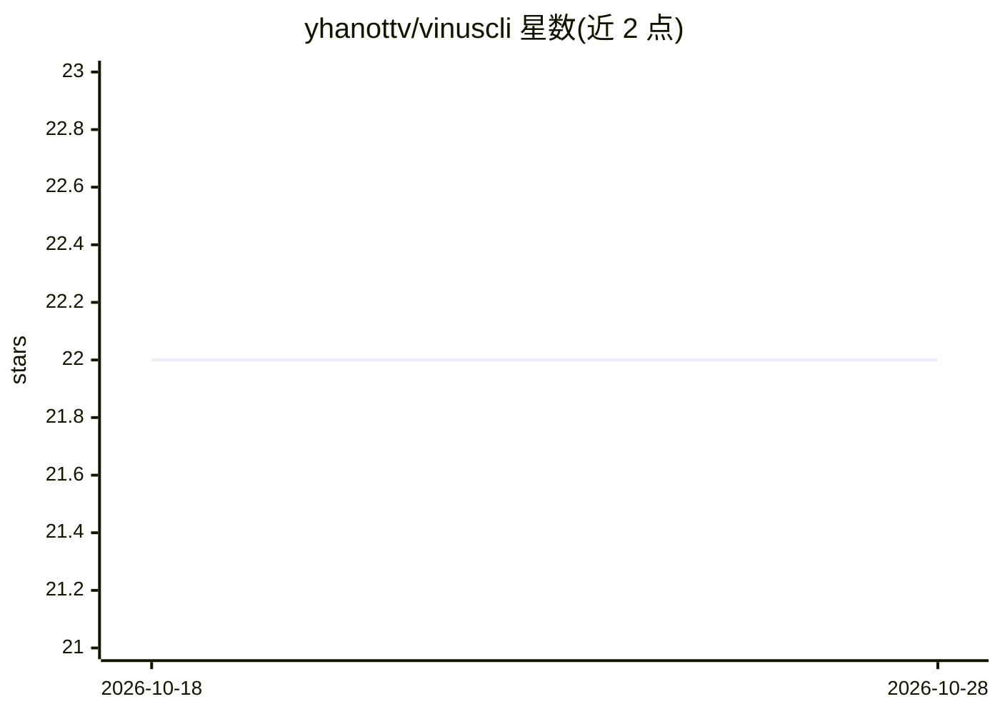

# yhanottv/vinuscli

⭐ 22 · NOASSERTION · 推送 2026-07-16 · [GitHub](https://github.com/yhanottv/vinuscli) · [官网](https://vinuscli.dev) · 个人维护

**终端 AI 编程 agent：读写文件、跑命令、自动迭代**

闭源分发的终端 AI 编程代理，通过单一 Vinus key 经托管端点访问 GPT、Claude、Gemini、Llama、Mistral 等模型并带自动降级链。提供读写文件、执行 shell、web/github 搜索等工具，写入前以红绿 diff 预览；内置 21 个编码技能包且 agent 可自写技能，支持 GitHub/Canva/Notion/Linear/IDA Pro 的 MCP 连接器，含 IDA Pro/Ghidra 逆向工作流。设 Plan/Manual/Auto 三档自主模式，按订阅计费而非按 token；经 npm 安装，需 Node.js ≥ 18。

## 筛选速览

| 维度 | 判定 | 备注 |
|---|---|---|
| AI 角色 | `ai-native` | 本体是模型或模型工具 |
| 许可风险 | `none` | NOASSERTION |
| 部署形态 | `library` | 以包/库形式分发 |
| 模型依赖 | — | README 未给出锁定关系 |
| 硬件要求 | — | 无带数字的原话,不猜 |
| 安装摩擦 | `low` | 无编译、无系统依赖或容器化 |
| 成熟度 | — | 结构信号不足 |

## 能力要点

- 单一 Vinus key 经托管端点访问多模型并带自动降级链
- 读写文件、执行 shell、diff 预览与 21 个内置技能包（可自写技能）
- GitHub/Notion/Linear/IDA Pro 等服务的 MCP 连接器
- Plan/Manual/Auto 三档自主模式切换

## 适用场景

- 在终端里让 agent 规划、编写、重构和调试代码
- 通过单一订阅访问多种前沿模型
- IDA Pro/Ghidra 逆向工程工作流辅助

## 场景标签

`编码 Agent` `网络安全` · 领域:编码与开发

## 证据(README 行号)

> L3: ### The AI coding agent that lives in your terminal.
> L23: A hands-on coding **agent**, not a chatbot. It reads and writes your files, runs

## 星数曲线

2026-10-18 22 → 2026-10-28 22（+0）

---
*卡片 v1 · prompt 1.4 · 生成 2026-10-28 · 置信度 high · 依据 README sha `847c430c0058` · [字段定义](../../DATASET.md)*
