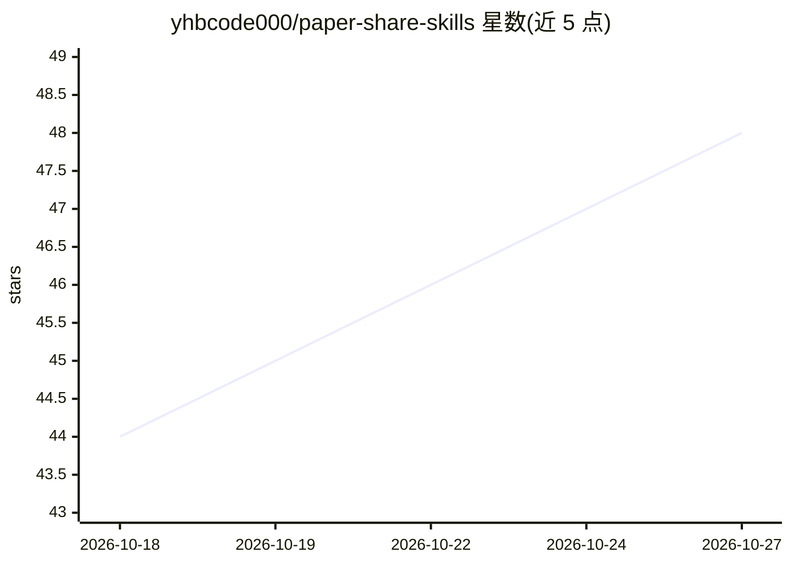

# yhbcode000/paper-share-skills

⭐ 48 · Python · Apache-2.0 · 推送 2026-08-12 · [GitHub](https://github.com/yhbcode000/paper-share-skills) · [官网](https://blog.yhbcode000.tech/paper-share-skills/) · 个人维护 · 中文 README

**论文转 B 站讲解视频的 agent 技能套件（Claude Code/Codex/OMP）**

面向 Claude Code、Codex CLI、OMP 三类 Agent CLI 的 8 个即插即用技能包：从 arXiv 下载论文 TeX 源码/PDF，经 MinerU 转 Markdown，生成 SUSTech Beamer 11 节幻灯片并用 lualatex 编译，edge-tts 逐页配音产出横竖双 MP4，再经 biliup 扫码登录投稿 B 站，由编排技能 paper-to-bilibili 按 slides/video/bilibili 三模式驱动并支持断点续跑。技能以目录复制方式安装，依赖 Python、TeX Live、ffmpeg 等环境变量配置，模板可换机构品牌。

## 筛选速览

| 维度 | 判定 | 备注 |
|---|---|---|
| AI 角色 | `ai-ecosystem` | LLM/agent 周边工具 |
| 许可风险 | `permissive` | Apache-2.0 |
| 部署形态 | `desktop` | 安装包/桌面程序 |
| 模型依赖 | — | README 未给出锁定关系 |
| 硬件要求 | — | 无带数字的原话,不猜 |
| 安装摩擦 | `medium` | 含编译或系统依赖之一 |
| 成熟度 | — | 结构信号不足 |

## 能力要点

- 8 个技能覆盖 arXiv 下载→MinerU→Beamer→配音视频→B 站投稿全流程
- 编排器支持 slides/video/bilibili 三模式与磁盘状态契约断点续跑
- 三端 Agent 通用安装（Claude Code / Codex CLI / OMP），技能与模板解耦可换机复用
- 无 NVIDIA GPU 时可装 CPU 版 torch，流水线照常运行（更慢）

## 适用场景

- 组会文献精读，自动生成结构化论文分享幻灯片
- 把论文做成配音讲解视频发布到 B 站或小红书
- 批量将论文 PDF 转为幻灯片/视频系列内容

## 场景标签

`科研工具` `语音合成` · 领域:内容生成

## 证据(README 行号)

> L3: **PDF 论文 → B 站讲解视频 一站式 AI 技能套件（Claude Code / Codex / OMP 通用）**
> L27: 每个技能都是一个普通目录：`SKILL.md`（YAML frontmatter：`name` + `description`）+ 脚本/模板，三种 Agent 通用：
> L31: |Claude Code|`~/.claude/skills/<name>/` 或项目 `.claude/skills/`|`cp -r paper-* pdf-to-markdown sustech-beamer-theme-f

## 星数曲线

2026-10-18 44 → 2026-10-27 48（+4）

---
*卡片 v1 · prompt 1.4 · 生成 2026-10-25 · 置信度 mid · 依据 README sha `52cb866f9ddc` · [字段定义](../../DATASET.md)*
