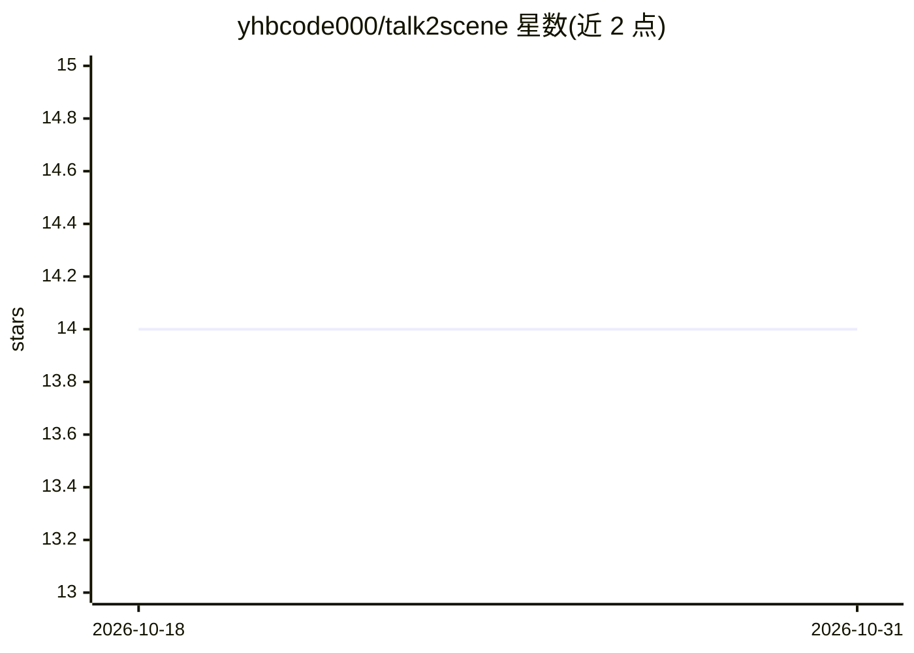

# yhbcode000/talk2scene

⭐ 14 · Python · Apache-2.0 · 推送 2026-02-10 · [GitHub](https://github.com/yhbcode000/talk2scene) · [官网](https://discover304.top/talk2scene/) · 个人维护 · 中文 README

**音频驱动的智能动画生成工具：从语音杂谈到场景动画**

解析音频或文本杂谈文件，经 Whisper/OpenAI API 转录文本与时间节点，再由 GPT-4o 推荐角色姿态（STA）、表情（EXP）、动作（ACT）、背景（BG）与 CG 插画，生成时间对齐的结构化场景事件数据，并可用 FFmpeg 合成预览视频。场景由五类资源层堆叠组成，CG 激活时替换全部图层。提供文本、批处理、视频、Redis 实时流四种运行模式，供内容创作者、教育工作者、虚拟主播使用。安装需 Python 3.11+、uv 与 FFmpeg，并需设置 OpenAI API key。

## 筛选速览

| 维度 | 判定 | 备注 |
|---|---|---|
| AI 角色 | `ai-native` | 本体是模型或模型工具 |
| 许可风险 | `permissive` | Apache-2.0 |
| 部署形态 | `None` |  |
| 模型依赖 | — | README 未给出锁定关系 |
| 硬件要求 | — | 无带数字的原话,不猜 |
| 安装摩擦 | `medium` | 含编译或系统依赖之一 |
| 成熟度 | — | 结构信号不足 |

## 能力要点

- 音频→转录→AI 推荐姿态/表情/动作/背景/CG 的完整管线
- 五层资源（BG/STA/ACT/EXP/CG）堆叠合成场景
- 文本、批处理、视频渲染、Redis 实时流四种模式
- 输出时间对齐的结构化场景事件数据，支持视频导出

## 适用场景

- 把访谈或杂谈音频自动转成带角色动画的可视化视频
- 为虚拟主播或 AI 角色演示生成时间同步的场景表现
- 教育讲解内容配上自动生成的角色动作与背景

## 场景标签

`视频生成` · 领域:内容生成

## 证据(README 行号)

> L11: Talk2Scene is an **audio-driven intelligent animation tool** that automatically parses voice dialogue files, recogn
> L23:     A[Audio] --> B[Transcription\nWhisper / OpenAI API]

## 星数曲线

2026-10-18 14 → 2026-10-31 14（+0）

---
*卡片 v1 · prompt 1.4 · 生成 2026-10-31 · 置信度 high · 依据 README sha `ed64787da1e2` · [字段定义](../../DATASET.md)*
