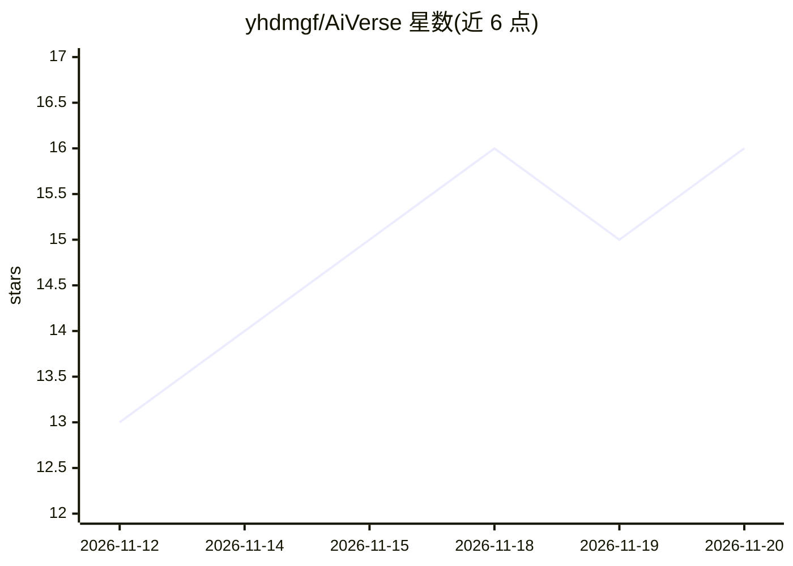

# yhdmgf/AiVerse

⭐ 16 · Kotlin · GPL-3.0 · 推送 2026-11-19 · [GitHub](https://github.com/yhdmgf/AiVerse) · [官网](https://aivapp.cn) · 个人维护 · 中文 README

**Android 上的通用 AI Coding Agent，内置 Linux 开发环境**

运行在 Android 的 AI 编程代理应用：基于 Termux 与 PRoot 内置 Alpine Linux 容器与终端，AI Agent 可读写文件、执行 Shell、运行构建工具，写代码到构建在手机本地完成；也可切换远程 SSH 服务器作为执行后端，并内置 sshExec 等远程工具与 Shizuku 执行后端。不内置模型，兼容 OpenAI/Anthropic/Gemini 三类协议，模型、密钥与端点由用户配置。提供子代理并行、四种运行模式、检查点回滚、MCP 连接、Git 可视化与 SFTP/FTP 同步。以 APK 安装包分发，要求 Android 8.0+。

## 筛选速览

| 维度 | 判定 | 备注 |
|---|---|---|
| AI 角色 | `ai-native` | 本体是模型或模型工具 |
| 许可风险 | `viral` | GPL-3.0 |
| 部署形态 | `None` |  |
| 模型依赖 | — | README 未给出锁定关系 |
| 硬件要求 | — | 无带数字的原话,不猜 |
| 安装摩擦 | `low` | 无编译、无系统依赖或容器化 |
| 成熟度 | — | 结构信号不足 |

## 能力要点

- 基于 Termux/PRoot 的 Alpine Linux 容器与终端，本地完成编码与构建
- 远程 SSH 模式：远程服务器作为执行后端，含 sshExec 等文件与命令工具
- 模型无关：兼容 OpenAI/Anthropic/Gemini 协议，自定义供应商与多 Key 轮换
- 四种运行模式（BUILD/PLAN/AUTO/EXPERT）与检查点回滚、MCP 支持

## 适用场景

- 在手机上用 AI Agent 完成编码、调试与构建全流程
- 把手机作为远程 SSH 项目的移动工作站
- 通过内置浏览器与 MCP 服务器扩展 AI 工具能力

## 场景标签

`编码 Agent` · 领域:编码与开发

## 证据(README 行号)

> L31: AiVerse 是运行在 Android 上的通用 AI Coding Agent，把一套完整的 Linux 开发环境装进手机：内置 Alpine Linux 容器与终端，AI Agent 能读写文件、执行 Shell 命令、运行
> L39: - **AI Agent** — 内置文件读写与编辑、Shell 执行、后台终端、代码与网页搜索、图片识别、待办清单等工具；流式输出并实时渲染 Markdown，长对话自动压缩上下文

## 星数曲线

2026-11-12 13 → 2026-11-20 16（+3）

---
*卡片 v1 · prompt 1.4 · 生成 2026-11-18 · 置信度 high · 依据 README sha `73fa212c3cee` · [字段定义](../../DATASET.md)*
