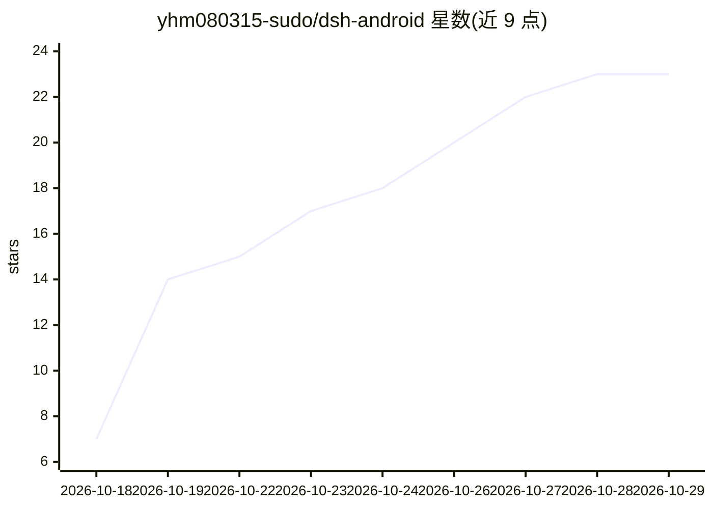

# yhm080315-sudo/dsh-android

⭐ 23 · Java · MIT · 推送 2026-10-26 · [GitHub](https://github.com/yhm080315-sudo/dsh-android) · 个人维护 · 中文 README

**把 DeepSeek Harness 打包成免 root 的独立 Android 应用**

将 DeepSeek Harness（DSH）连同 Node、bash、ripgrep、coreutils 等 Termux bionic 运行时整体内嵌进一个 APK，装包即用，无需 Termux、proot、root 或电脑。WebView 直接运行同源 DSH Web 界面，并内置截屏/点按/输入/OCR 等设备控制接口，按无障碍+投屏、Shizuku、root 三级提权通道选择。限制：targetSdk 须为 28 无法上架 Google Play，APK 约 130–180 MB，原生 npm 模块不支持，负载需持续打十几处补丁维护。构建需 Linux 构建机、JDK 21、Android SDK 工具链与 D8，不用 Gradle。

## 筛选速览

| 维度 | 判定 | 备注 |
|---|---|---|
| AI 角色 | `ai-native` | 本体是模型或模型工具 |
| 许可风险 | `permissive` | MIT |
| 部署形态 | `None` |  |
| 模型依赖 | — | README 未给出锁定关系 |
| 硬件要求 | — | 无带数字的原话,不猜 |
| 安装摩擦 | `medium` | 含编译或系统依赖之一 |
| 成熟度 | — | 结构信号不足 |

## 能力要点

- 整个 Node 运行时与 DSH 内嵌进单 APK，免 Termux/proot/root
- 设备控制按操作类型在无障碍+投屏 / Shizuku / root 三条通道间路由
- WebView 运行同源 DSH Web 界面，桌面端插件/皮肤/agent 一致
- 附带 Android 平台适配坑清单（seccomp、W^X、link() 等）

## 适用场景

- 在 Android 手机上直接使用 DeepSeek Harness 而不装 Termux
- 让 agent 通过截屏/点按/输入操控本机设备
- 参考其 bionic 适配与打包方案移植其他 Node 应用到 Android

## 场景标签

`编码 Agent` `GUI 自动化` · 领域:效率与自动化

## 证据(README 行号)

> L4: 把 DeepSeek Harness（下称 DSH）打包成**独立 Android 应用**。
> L6: 装一个 APK 就能用：**不需要 Termux、不需要 proot、不需要电脑**。运行时（Node、bash、ripgrep、coreutils）全部内嵌在 APK 里。
> L16: - 额外内置一块**设备控制接口**（截屏 / 点按 / 滑动 / 输入 / OCR / 启动应用），走 `su` 通道

## 星数曲线

2026-10-18 7 → 2026-10-29 23（+16）

---
*卡片 v1 · prompt 1.4 · 生成 2026-10-27 · 置信度 high · 依据 README sha `3cfcc6c10de7` · [字段定义](../../DATASET.md)*
