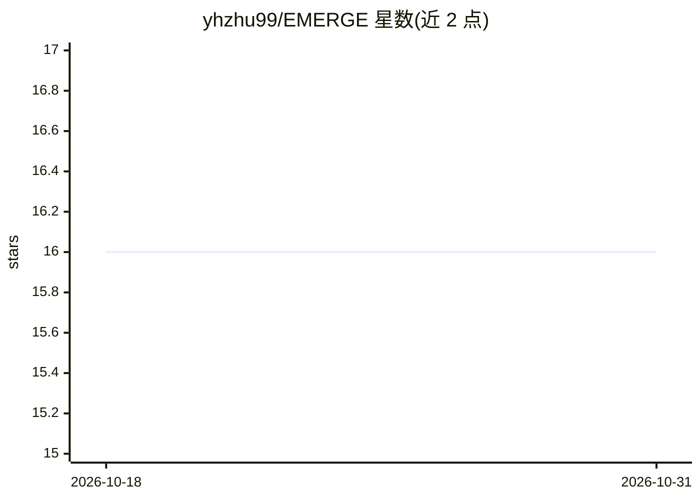

# yhzhu99/EMERGE

⭐ 16 · Python · MIT · 推送 2026-05-24 · [GitHub](https://github.com/yhzhu99/EMERGE) · [官网](https://dl.acm.org/doi/10.1145/3627673.3679582) · 组织维护

**多模态电子健康记录预测建模的研究框架（CIKM 2024 论文官方实现）**

EMERGE 是 CIKM 2024 论文的官方实现：从临床文本抽取疾病实体、从时序信号提取异常特征，基于 PrimeKG 知识图谱检索疾病知识并生成患者级 RAG 摘要，再用交叉注意力融合时序、临床文本与 RAG 摘要表征以做预测建模。采用 OneEHR 三表输入格式，支持 MIMIC-III/IV 数据集，提供分阶段流水线（下载/转换/预处理/训练）。默认配置用本地 TF-IDF/SVD 编码器与规则实体抽取，无需下载大模型或 LLM；可选切换 BGE-M3、Clinical-Longformer、Qwen3-Embedding 等编码器及 OpenAI 兼容端点（Qwen/vLLM/DeepSeek）做实体抽取与摘要生成。面向科研复现与基准实验。

## 筛选速览

| 维度 | 判定 | 备注 |
|---|---|---|
| AI 角色 | `ai-native` | 本体是模型或模型工具 |
| 许可风险 | `permissive` | MIT |
| 部署形态 | `None` |  |
| 模型依赖 | local-ok | 支持本地模型 |
| 硬件要求 | — | 无带数字的原话,不猜 |
| 安装摩擦 | `low` | 无编译、无系统依赖或容器化 |
| 成熟度 | — | 结构信号不足 |

## 能力要点

- 时序/临床文本/RAG 摘要三模态交叉注意力融合预测
- 从 PrimeKG 检索疾病知识并生成患者级 RAG 摘要
- 分阶段流水线：download/convert/preprocess/train
- 默认配置用本地 TF-IDF/SVD 与规则实体抽取，无 LLM 依赖可复现运行

## 适用场景

- 在 MIMIC-III/IV 基准上复现论文的多模态 EHR 预测结果
- 用 PrimeKG 知识检索增强 EHR 死亡率等预测任务
- 替换 LM 编码器或接入 OpenAI 兼容端点做消融实验

## 场景标签

`RAG` `科研工具` `多模态` · 领域:知识与检索

## 证据(README 行号)

> L3: Official implementation of the paper **EMERGE: Enhancing Multimodal Electronic Health Records Predictive Modeling wi
> L7: EMERGE enhances multimodal EHR prediction by extracting abnormal time-series signals and disease entities from clini

## 星数曲线

2026-10-18 16 → 2026-10-31 16（+0）

---
*卡片 v1 · prompt 1.4 · 生成 2026-10-30 · 置信度 high · 依据 README sha `401ab4de1102` · [字段定义](../../DATASET.md)*
