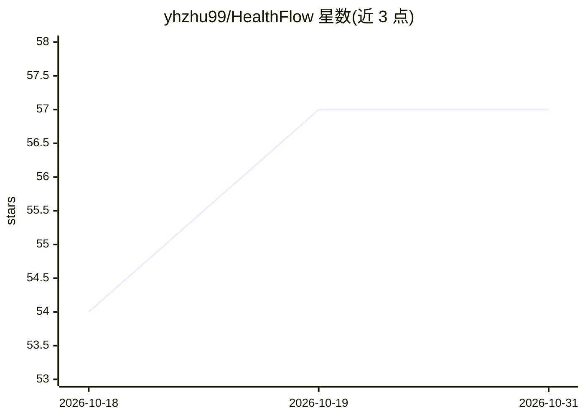

# yhzhu99/HealthFlow

⭐ 57 · Python · 推送 2026-09-23 · [GitHub](https://github.com/yhzhu99/HealthFlow) · [官网](https://healthflow.medx-pku.com/) · 组织维护

**自动化 EHR 分析的自进化多智能体框架**

面向电子健康记录（EHR）分析的多智能体框架，将临床分析请求转化为受治理的工作流：Meta 智能体画像任务并生成计划，Executor 通过外部编码智能体后端（默认 opencode，可选 claude/codex/pi）执行代码与工具调用，Evaluator 审查运行痕迹与 EHR 有效性风险，Reflector 将经验写回长期记忆供后续任务复用。提供 CLI、交互终端与浏览器 UI 三种模式，附带五个基准套件与数据发布包。需 Python 3.12+、uv、执行器后端及相应 LLM API key。论文发表于 npj Digital Medicine 2026。

## 筛选速览

| 维度 | 判定 | 备注 |
|---|---|---|
| AI 角色 | `ai-native` | 本体是模型或模型工具 |
| 许可风险 | `none` | — |
| 部署形态 | `desktop` | 安装包/桌面程序 |
| 模型依赖 | locked-api |  |
| 硬件要求 | — | 无带数字的原话,不猜 |
| 安装摩擦 | `low` | 无编译、无系统依赖或容器化 |
| 成熟度 | — | 结构信号不足 |

## 能力要点

- 四智能体循环：计划-执行-评估-反思，支持修复与重试
- 长期经验记忆（JSONL）按任务族/数据集签名/风险标签条件检索
- 三种运行模式：非交互 CLI、交互终端、浏览器 UI
- 在 EHRFlowBench/MedAgentBoard/MedAgentsBench/HLE/CureBench 五个基准上评估

## 适用场景

- 把临床分析请求自动转化为带方法与局限说明的分析报告
- 在多个医学基准套件上批量评测智能体执行结果
- 通过经验记忆积累可复用的分析工作流与代码片段

## 场景标签

`多智能体` `Agent 记忆` `模型评测` `数据分析` · 领域:Agent 开发

## 证据(README 行号)

> L10: HealthFlow is a strategically self-evolving multi-agent framework for automating electronic health record (EHR) ana
> L165: 1. **Planning**: the meta agent builds an EHR-aware task context, retrieves compatible memory, and emits a structu
> L166: 2. **Execution**: the executor backend implements the plan in a sandboxed workspace using code, shell commands, an

## 星数曲线

2026-10-18 54 → 2026-10-31 57（+3）

---
*卡片 v1 · prompt 1.4 · 生成 2026-10-24 · 置信度 high · 依据 README sha `c66b36fbe58e` · [字段定义](../../DATASET.md)*
