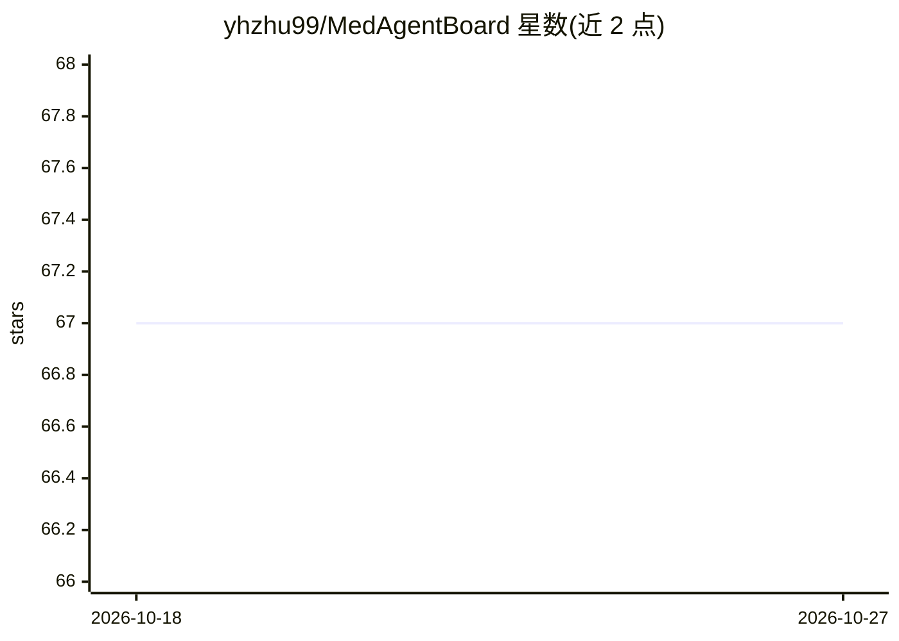

# yhzhu99/MedAgentBoard

⭐ 67 · Python · 推送 2026-09-04 · [GitHub](https://github.com/yhzhu99/MedAgentBoard) · [官网](https://medagentboard.netlify.app/) · 组织维护

**医疗任务多智能体/单LLM/传统方法的评测基准**

NeurIPS 2025 Datasets & Benchmarks Track 论文的配套基准套件，覆盖四类医疗任务：医学（视觉）问答、患者版通俗摘要生成、结构化 EHR 预测建模、临床工作流自动化，数据模态含文本、医学影像和结构化 EHR。系统比较多智能体协作、单 LLM 与传统非 LLM 方法，实验发现多智能体在工作流自动化中提升任务完整度，但在医学 VQA 与 EHR 预测上传统专用方法仍保持更高性能。提供 Python 代码、数据集、提示词与实验结果，MIMIC 相关数据因 PhysioNet 授权限制不包含。

## 筛选速览

| 维度 | 判定 | 备注 |
|---|---|---|
| AI 角色 | `ai-ecosystem` | LLM/agent 周边工具 |
| 许可风险 | `none` | — |
| 部署形态 | `None` |  |
| 模型依赖 | — | README 未给出锁定关系 |
| 硬件要求 | — | 无带数字的原话,不猜 |
| 安装摩擦 | `low` | 无编译、无系统依赖或容器化 |
| 成熟度 | — | 结构信号不足 |

## 能力要点

- 四类医疗任务、三种数据模态的统一评测基准
- 同时比较多智能体、单 LLM 与传统非 LLM 方法
- 代码、数据集、提示词与实验结果开源（Zenodo）
- 实验结论：多智能体并非在所有任务中优于单 LLM 或专用传统方法

## 适用场景

- 为医疗 AI 选型比较多智能体与单 LLM/传统方法的实证表现
- 在医学 QA、EHR 预测等任务上复现基准实验
- 研究者复用基准框架评测新的医疗智能体方案

## 场景标签

`模型评测` · 领域:评测与运维

## 证据(README 行号)

> L16: **MedAgentBoard** is a comprehensive benchmark for the systematic evaluation of multi-agent collaboration, single-L
> L32: * **Comprehensive Benchmark:** Provides a platform for rigorous evaluation and extensive comparative analysis of mu

## 星数曲线

2026-10-18 67 → 2026-10-27 67（+0）

---
*卡片 v1 · prompt 1.4 · 生成 2026-10-24 · 置信度 high · 依据 README sha `c98107cb932e` · [字段定义](../../DATASET.md)*
