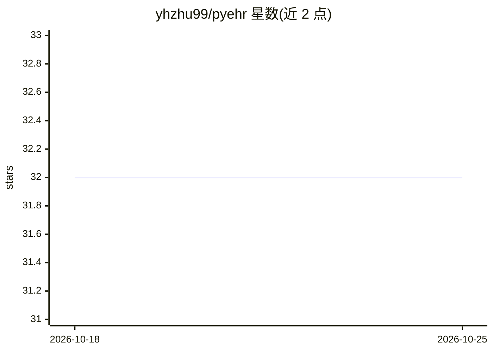

# yhzhu99/pyehr

⭐ 32 · Python · MIT · 推送 2026-05-24 · [GitHub](https://github.com/yhzhu99/pyehr) · [官网](https://www.cell.com/patterns/fulltext/S2666-3899(24)00050-3) · 组织维护 · 中文 README

**面向 COVID-19 ICU EHR 数据的预测建模基准工具包**

Patterns 论文的官方实现，提供可复现的电子健康记录（EHR）预处理、训练、调参与评测全流程管线，基于两个真实新冠 ICU 数据集 TJH 与 CDSL。覆盖早期死亡结局预测、住院时长预测及多任务/两阶段预测三类任务；模型库包含随机森林、XGBoost 等传统机器学习模型，MLP/LSTM/Transformer 等深度学习模型，以及 RETAIN、ConCare、GRASP 等 EHR 专用模型。提供任务专用损失（time-aware loss、ES、OSMAE）与搜索好的超参数，基于 uv 管理 Python 3.12 环境，数据需自行申请获取。

## 筛选速览

| 维度 | 判定 | 备注 |
|---|---|---|
| AI 角色 | `ai-native` | 本体是模型或模型工具 |
| 许可风险 | `permissive` | MIT |
| 部署形态 | `None` |  |
| 模型依赖 | — | README 未给出锁定关系 |
| 硬件要求 | — | 无带数字的原话,不猜 |
| 安装摩擦 | `low` | 无编译、无系统依赖或容器化 |
| 成熟度 | — | 结构信号不足 |

## 能力要点

- 覆盖传统 ML、深度学习与 EHR 专用模型三类共 17+ 种模型
- 支持死亡结局、住院时长及多任务/两阶段预测
- 提供 time-aware loss、ES、OSMAE 等任务专用损失与评测指标
- 附搜索好的超参数与 W&B 调参脚本

## 适用场景

- 在 TJH/CDSL 数据集上复现 COVID-19 ICU 预测基准
- 比较 EHR 专用模型与通用模型的预测表现
- 开展住院时长与死亡结局的多任务预测研究

## 场景标签

`模型评测` · 领域:评测与运维

## 证据(README 行号)

> L3: PyEHR is the official implementation of our *Patterns* paper, "A comprehensive benchmark for COVID-19 predictive mod
> L16: - clinically motivated prediction tasks for COVID-19 ICU patients;
> L17: - traditional machine learning, basic deep learning, and EHR-specific predictive models;

## 星数曲线

2026-10-18 32 → 2026-10-25 32（+0）

---
*卡片 v1 · prompt 1.4 · 生成 2026-10-25 · 置信度 high · 依据 README sha `0031bdd215e7` · [字段定义](../../DATASET.md)*
