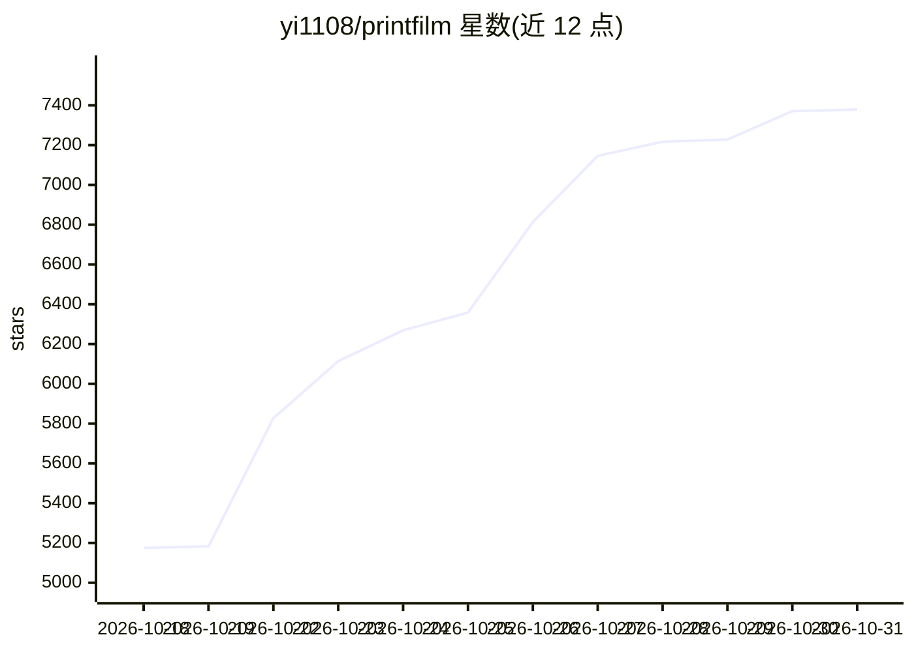

# yi1108/printfilm

⭐ 7,379 · Python · MIT · 推送 2026-10-29 · [GitHub](https://github.com/yi1108/printfilm) · [官网](https://www.printfilm.com) · 个人维护 · 中文 README

**自托管的 AI 短视频与 AI 漫剧创作平台，从文案到成片**

模板驱动的创作平台，走主题/剧本→分镜→生图→生视频→FFmpeg 合成成片的流水线，覆盖两条产品线：AI 漫剧（大纲、分集、剧本解析、角色场景资产复用）与 AI 短视频（20+ 风格模板、full/image_text 两种模式、单镜重绘）。生图生视频统一走 TokenFree New API（OpenAI 兼容），口播由 Seedance 出片时生成。提供进程内任务平台、管理后台、开放 API /api/v1 与可选计费，Docker 一键启动自托管，无 Key 时仅 ARK_MOCK 模式看界面。

## 筛选速览

| 维度 | 判定 | 备注 |
|---|---|---|
| AI 角色 | `ai-native` | 本体是模型或模型工具 |
| 许可风险 | `permissive` | MIT |
| 部署形态 | `self-host` | docker 或自建部署 |
| 模型依赖 | — | README 未给出锁定关系 |
| 硬件要求 | — | 无带数字的原话,不猜 |
| 安装摩擦 | `low` | 无编译、无系统依赖或容器化 |
| 成熟度 | — | 结构信号不足 |

## 能力要点

- 分镜流水线：剧本→分镜→生图→生视频→FFmpeg 合成，各阶段可单镜重做
- 漫剧资产库支持角色、场景、道具复用，保持分集一致性
- 文/图/视频统一走 TokenFree New API，模型可在管理后台更换
- 进程内任务平台（scheduler/executor/poller），无需单独 Celery Worker

## 适用场景

- 把产品卖点做成可投放的短视频获客片
- 从大纲到分集制作角色场景一致的 AI 漫剧
- 通过工具中心单点生成文生图、文生视频等素材
- 用 Docker 在自己服务器上自托管整套创作平台

## 场景标签

`AI 写作` `图像生成` `视频生成` · 领域:内容生成

## 证据(README 行号)

> L8: > **把故事做成能播的片子** — AI 漫剧与 AI 短视频，从文案到成片。
> L10: 模板驱动的创作平台：主题 / 剧本 → 分镜 → 生图 → 生视频 → 成片。口播由 Seedance 出片时生成，无需单独配音。
> L70:     → 生视频（Seedance 自带口播）

## 星数曲线

2026-10-18 5,175 → 2026-10-31 7,379（+2,204）

---
*卡片 v1 · prompt 1.4 · 生成 2026-10-20 · 置信度 high · 依据 README sha `6adcb74dff30` · [字段定义](../../DATASET.md)*
