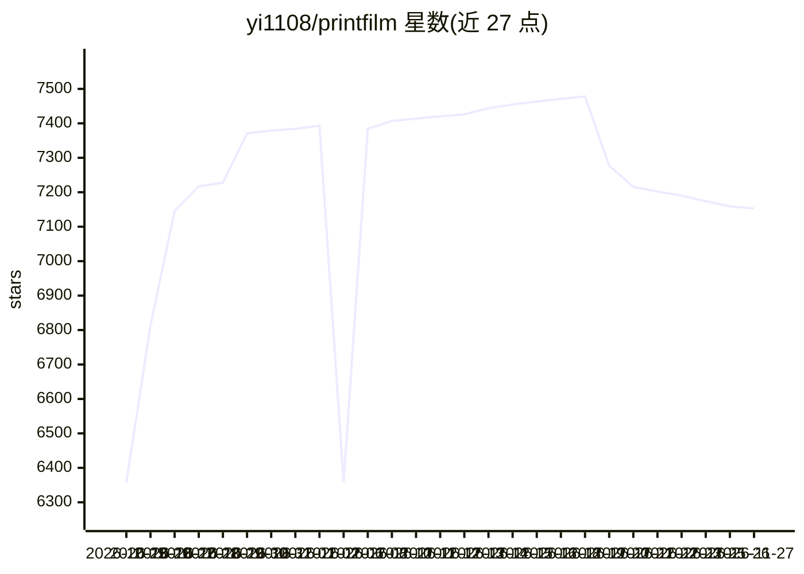

# yi1108/printfilm

⭐ 7,153 · Python · MIT · 推送 2026-11-25 · [GitHub](https://github.com/yi1108/printfilm) · [官网](https://www.printfilm.com) · 个人维护 · 中文 README

**把文案想法做成短视频与 AI 漫剧的自托管创作平台**

提供两条创作产品线：AI 漫剧（从大纲到分集剧本、资产库、分镜编辑）与 AI 短视频（四款画风、文案生成分镜、参考图延续角色风格、图生视频或静图加 TTS 配音与 FFmpeg 合成）。各阶段完成后停下等待用户检查再继续。技术栈为 FastAPI + PostgreSQL/Redis 后端与 React 前端，通过 TokenFree New API 接入文字/图/视频模型，Key 可在管理后台配置；内置 scheduler/executor/poller 任务平台，支持 Docker 一键部署与可选计费。

## 筛选速览

| 维度 | 判定 | 备注 |
|---|---|---|
| AI 角色 | `ai-native` | 本体是模型或模型工具 |
| 许可风险 | `permissive` | MIT |
| 部署形态 | `desktop` | 安装包/桌面程序 |
| 模型依赖 | — | README 未给出锁定关系 |
| 硬件要求 | — | 无带数字的原话,不猜 |
| 安装摩擦 | `low` | 无编译、无系统依赖或容器化 |
| 成熟度 | — | 结构信号不足 |

## 能力要点

- 漫剧与短视频共用同一套上游生成能力
- 每镜使用固定画风参考图并参考前镜延续角色视觉
- 进程内任务平台，无需单独 Celery Worker
- 管理后台可换模型路由与 TokenFree Key，不必改代码

## 适用场景

- 把产品卖点做成可投放的获客短片
- 从一句话大纲生成保持角色一致性的分集短剧
- 在工具中心单独生成图片、视频、音频素材
- 用 Docker 在自己机器上自托管一套视频生成流水线

## 场景标签

`AI 写作` `语音合成` `视频生成` `图像生成` · 领域:内容生成

## 证据(README 行号)

> L8: > **把故事做成能播的片子** — AI 漫剧与 AI 短视频，从文案到成片。
> L103: |AI|TokenFree New API（文字 / 图 / 视频）|
> L178: 开源版文字 / 图 / 视频统一走 **TokenFree New API**（OpenAI 兼容：`https://www.tokenfree.com/v1`）。没有 Key 时只能 `ARK_MOCK=true` 看界面，不

## 星数曲线

2026-10-25 6,358 → 2026-11-27 7,153（+795）

---
*卡片 v1 · prompt 1.4 · 生成 2026-11-22 · 置信度 high · 依据 README sha `2392094c9fb7` · [字段定义](../../DATASET.md)*
