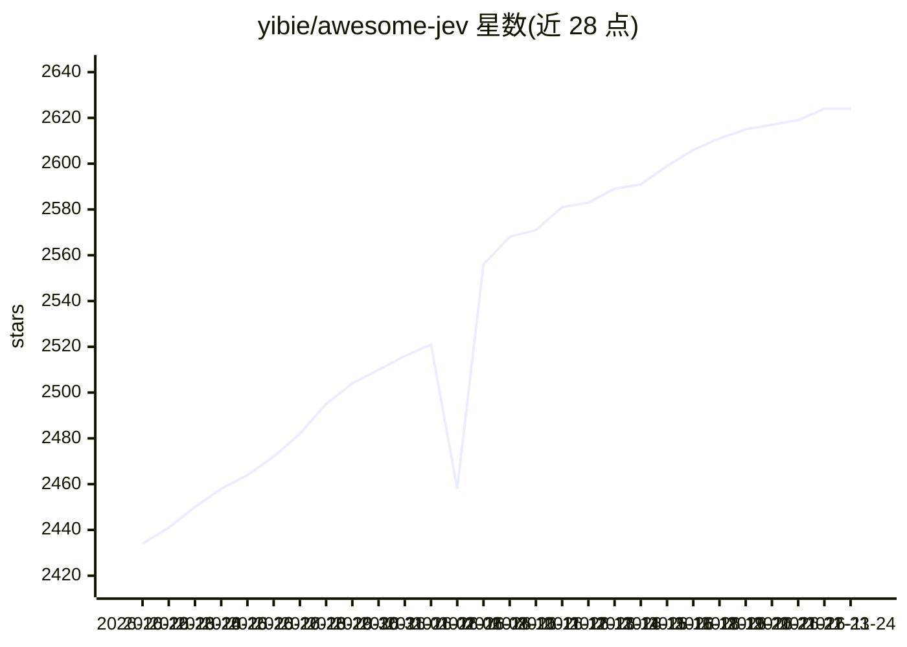

# yibie/awesome-jev

⭐ 2,624 · Python · 推送 2026-11-21 · [GitHub](https://github.com/yibie/awesome-jev) · 个人维护

**基于 Jev 类型化决策模型的开源项目策展清单**

收录基于 Jev（TypeSafe AI 的 System One 类型化决策模型）构建的公开项目与实践清单。Jev 不生成对话，而是接收非结构化状态加类型化问题，返回带置信度的类型化决策（选择/评分/布尔值），用于分类、路由、评分、验证与 agent 护栏。清单按应用领域分 16 个类别组织（含分类路由、验证护栏、基础设施/SDK、Agent 决策等），并提供收录规则说明：仅要求公开、可引用、真实使用 Jev，不审核代码质量与安全性。维护者声明收录不代表背书，并提示对批量提交保持警惕。

## 筛选速览

| 维度 | 判定 | 备注 |
|---|---|---|
| AI 角色 | `ai-knowledge` | 知识聚合/清单类 |
| 许可风险 | `none` | — |
| 部署形态 | `None` |  |
| 模型依赖 | — | README 未给出锁定关系 |
| 硬件要求 | — | 无带数字的原话,不猜 |
| 安装摩擦 | `low` | 无编译、无系统依赖或容器化 |
| 成熟度 | — | 结构信号不足 |

## 能力要点

- 按应用领域组织 16 个类别、600+ 条目，首页聚合最新收录
- 提供明确收录标准与收录≠背书的自我核查清单
- 按编码 agent 标签（Claude Code/Pi/Codex 等）浏览条目
- 专门收录公开实践信号（讨论串、访谈）的类别

## 适用场景

- 寻找用类型化决策替代 LLM 判断的具体项目参考
- 调研 Jev 在生产工作流中的落地模式
- 了解跨行业可迁移的类型化决策模式

## 场景标签

`精选清单` · 领域:学习与行业

## 证据(README 行号)

> L1: # awesome-jev
> L3: A curated awesome list of public projects and practices built on Jev, TypeSafe AI's System One model for typed decis
> L27: An entry should meet all of the following:

## 星数曲线

2026-10-22 2,434 → 2026-11-24 2,624（+190）

---
*卡片 v1 · prompt 1.4 · 生成 2026-11-23 · 置信度 high · 依据 README sha `6a40414affa0` · [字段定义](../../DATASET.md)*
