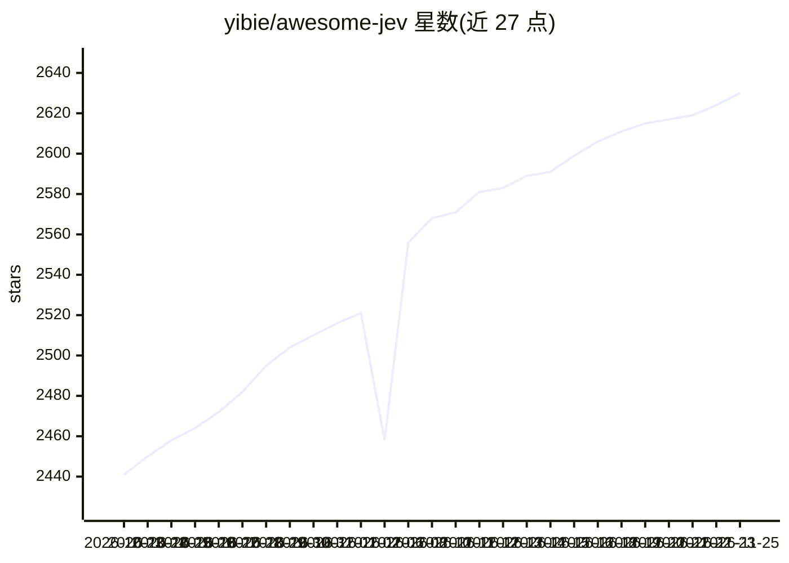

# yibie/awesome-jev

⭐ 2,630 · Python · 推送 2026-11-23 · [GitHub](https://github.com/yibie/awesome-jev) · 个人维护 · 中文 README

**基于 Jev 类型化决策模型构建的项目与实践清单**

围绕 TypeSafe AI 的 Jev 模型（输入非结构化状态与类型化问题，返回带置信度的类型化决策）维护的 awesome 清单：收录公开项目、集成与讨论，按分类路由、验证护栏、评分排序、Agent 决策、基础设施/SDK 等 16 类组织，共 700 余条，并支持按编码代理（Claude Code/Codex/Pi 等）检索。清单仅做收录规则校验，不审查代码质量、安全性或可运行性，并对同日批量提交的项目提示风险。

## 筛选速览

| 维度 | 判定 | 备注 |
|---|---|---|
| AI 角色 | `ai-knowledge` | 知识聚合/清单类 |
| 许可风险 | `none` | — |
| 部署形态 | `None` |  |
| 模型依赖 | — | README 未给出锁定关系 |
| 硬件要求 | — | 无带数字的原话,不猜 |
| 安装摩擦 | `low` | 无编译、无系统依赖或容器化 |
| 成熟度 | — | 结构信号不足 |

## 能力要点

- 16 个类别组织 700+ 条基于 Jev 的公开项目与实践
- 收录规则：公开可引用且真实使用 Jev 做类型化决策
- 按编码代理分类检索（Multi/Claude Code/Pi/Codex 等）
- 明确声明收录非背书，提供采用前自查清单

## 适用场景

- 查找某个决策场景（分类/路由/评分）下使用 Jev 的已有项目
- 了解类型化决策模式在各行业的落地方式
- 在采用清单内项目前按自查清单做尽调

## 场景标签

`精选清单` · 领域:学习与行业

## 证据(README 行号)

> L3: A curated awesome list of public projects and practices built on Jev, TypeSafe AI's System One model for typed decis
> L7: Jev is not a chat model. It takes unstructured state plus a **typed question** and returns a **typed decision** — a 
> L62: - Classification & Routing — 79 entries

## 星数曲线

2026-10-23 2,441 → 2026-11-25 2,630（+189）

---
*卡片 v1 · prompt 1.4 · 生成 2026-11-24 · 置信度 high · 依据 README sha `cc5ca18b6549` · [字段定义](../../DATASET.md)*
