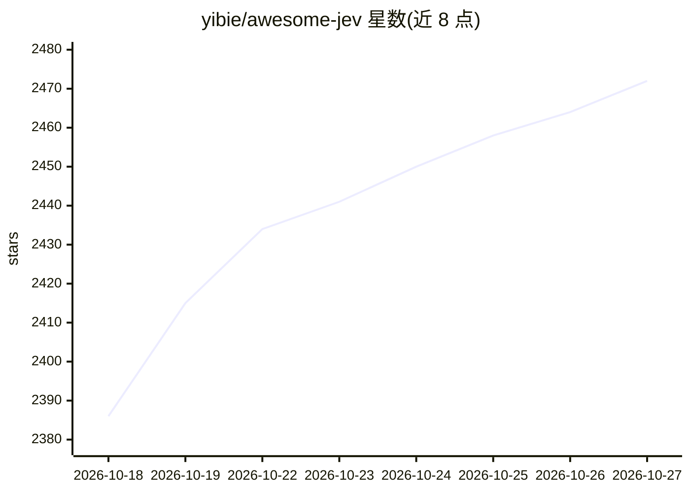

# yibie/awesome-jev

⭐ 2,472 · Python · 推送 2026-10-26 · [GitHub](https://github.com/yibie/awesome-jev) · 个人维护

**基于 Jev 类型化决策模型的公开项目策展清单**

收录基于 TypeSafe AI 的 System One 模型 Jev（输入非结构化状态与类型化问题，输出带置信度的类型化决策）构建的公开项目与实践讨论。条目按分类路由、验证护栏、评分排序、Agent 决策、基础设施/SDK 等约 16 个类别组织，共数百条。仅应用收录规则（公开可引用、真实使用 Jev、一句话摘要），不审查代码质量、安全性或成熟度，并提示对同日批量提交保持谨慎；列表本身不提供安装或运行内容。

## 筛选速览

| 维度 | 判定 | 备注 |
|---|---|---|
| AI 角色 | `ai-knowledge` | 知识聚合/清单类 |
| 许可风险 | `none` | — |
| 部署形态 | `None` |  |
| 模型依赖 | — | README 未给出锁定关系 |
| 硬件要求 | — | 无带数字的原话,不猜 |
| 安装摩擦 | `low` | 无编译、无系统依赖或容器化 |
| 成熟度 | — | 结构信号不足 |

## 能力要点

- 按 16 个类别组织条目，如分类路由 73 条、基础设施/SDK/集成 118 条
- 仅应用收录规则，不审查质量，收录不等于背书
- 提供按编码 Agent（Claude Code/Pi/Codex 等）查找条目的可选标签

## 适用场景

- 查找已在生产工作流中使用 Jev 做类型化决策的项目
- 了解跨行业的决策模式与集成方式
- 在采用条目前按官方检查清单自行核验

## 场景标签

`精选清单` · 领域:学习与行业

## 证据(README 行号)

> L3: A curated awesome list of public projects and practices built on Jev, TypeSafe AI's System One model for typed decis
> L7: Jev is not a chat model. It takes unstructured state plus a **typed question** and returns a **typed decision** — a 

## 星数曲线

2026-10-18 2,386 → 2026-10-27 2,472（+86）

---
*卡片 v1 · prompt 1.4 · 生成 2026-10-21 · 置信度 high · 依据 README sha `ffa61c0243ab` · [字段定义](../../DATASET.md)*
