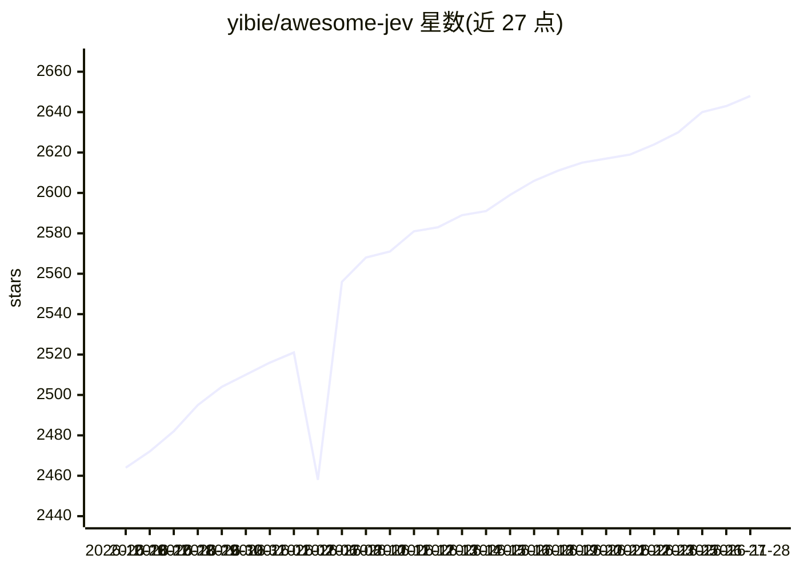

# yibie/awesome-jev

⭐ 2,648 · Python · 推送 2026-11-27 · [GitHub](https://github.com/yibie/awesome-jev) · 个人维护 · 中文 README

**基于 Jev 类型化决策模型的开源项目策展清单**

围绕 TypeSafe AI 的 Jev（输入非结构化状态与类型化问题、返回带置信度的类型化决策）构建的 awesome 清单，聚合公开项目、集成与实践讨论。收录规则要求条目公开可引用且真实使用 Jev，并明确声明收录不代表背书、不审核代码质量与安全；按分类、路由、验证护栏、评分等 15+ 类组织，共 700 余条，另提供按编码代理（Claude Code、Codex、Cline 等）浏览的标签索引。

## 筛选速览

| 维度 | 判定 | 备注 |
|---|---|---|
| AI 角色 | `ai-knowledge` | 知识聚合/清单类 |
| 许可风险 | `none` | — |
| 部署形态 | `None` |  |
| 模型依赖 | — | README 未给出锁定关系 |
| 硬件要求 | — | 无带数字的原话,不猜 |
| 安装摩擦 | `low` | 无编译、无系统依赖或容器化 |
| 成熟度 | — | 结构信号不足 |

## 能力要点

- 700+ 条目按 15+ 个应用类别组织，每条附一句话摘要
- 按编码代理（Multi/Claude Code/Pi/Codex 等）打标浏览
- 明确的收录标准与'收录非背书'声明，附采用前自查清单

## 适用场景

- 为业务中的分类、路由、评分场景查找基于 Jev 的现成实现
- 了解类型化决策模式在各行业的落地方式
- 为自己的编码代理寻找 Jev 集成工具（如 skill router、compact 工具）

## 场景标签

`精选清单` · 领域:学习与行业

## 证据(README 行号)

> L1: # awesome-jev
> L3: A curated awesome list of public projects and practices built on Jev, TypeSafe AI's System One model for typed decis
> L9: The repository treats all categories equally — each entry lives in exactly one category, chosen by its direct Jev ap

## 星数曲线

2026-10-26 2,464 → 2026-11-28 2,648（+184）

---
*卡片 v1 · prompt 1.4 · 生成 2026-11-28 · 置信度 high · 依据 README sha `af826a56a222` · [字段定义](../../DATASET.md)*
