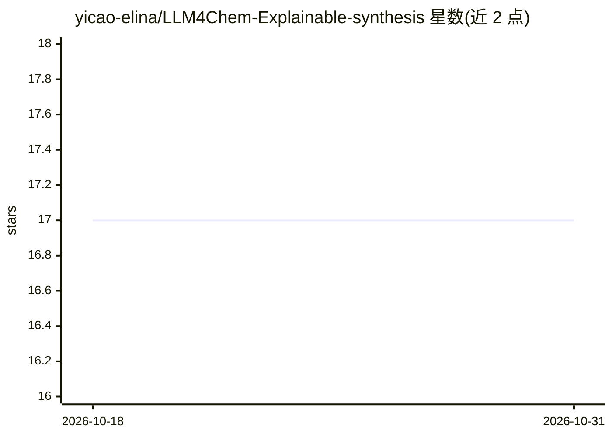

# yicao-elina/LLM4Chem-Explainable-synthesis

⭐ 17 · Python · MIT · 推送 2026-04-10 · [GitHub](https://github.com/yicao-elina/LLM4Chem-Explainable-synthesis) · 个人维护

**面向材料科学的因果推理+LLM 框架：预测材料性质与逆向设计合成方案**

ARIA 将因果知识图谱（DAG 表示合成-性质关系）与 LLM 机制解释结合，面向材料科学研究者提供双模式推理：正向预测（合成条件→材料性质）与逆向设计（目标性质→合成方案建议），输出含置信度评分与机制解释。技术栈包括 NetworkX 图编码、Sentence-BERT 嵌入相似度、链式推理可视化；以 Streamlit 应用形式提供，通过 git clone 源码 + conda/pip 本地安装，需配置知识图谱 JSON 路径与 API keys。

## 筛选速览

| 维度 | 判定 | 备注 |
|---|---|---|
| AI 角色 | `ai-native` | 本体是模型或模型工具 |
| 许可风险 | `permissive` | MIT |
| 部署形态 | `None` |  |
| 模型依赖 | — | README 未给出锁定关系 |
| 硬件要求 | — | 无带数字的原话,不猜 |
| 安装摩擦 | `low` | 无编译、无系统依赖或容器化 |
| 成熟度 | — | 结构信号不足 |

## 能力要点

- 正向预测与逆向设计双模式因果推理
- 因果知识图谱（DAG）+ Sentence-BERT 嵌入相似度的类比推理
- 输出含置信度评分、机制解释与不确定性分析
- 支持用户以 JSON 格式扩展自有研究数据构建知识图谱

## 适用场景

- 给定温度/掺杂剂等合成条件，预测材料性质并获得机制解释
- 按目标性质（如离子电导率）获取推荐的合成方案与替代路线
- 将自有论文数据转为知识图谱节点，扩展因果推理范围

## 场景标签

`知识图谱` `科研工具` · 领域:知识与检索

## 证据(README 行号)

> L36: 1. **🔮 Forward Prediction Protocol**: `Synthesis Conditions → Material Properties`
> L40: 2. **🎯 Inverse Design Protocol**: `Target Properties → Synthesis Recommendations`
> L52: - **LLM Mechanistic Generation**: LLM model integration for scientific explanation synthesis

## 星数曲线

2026-10-18 17 → 2026-10-31 17（+0）

---
*卡片 v1 · prompt 1.4 · 生成 2026-10-29 · 置信度 high · 依据 README sha `2305f6f007a2` · [字段定义](../../DATASET.md)*
