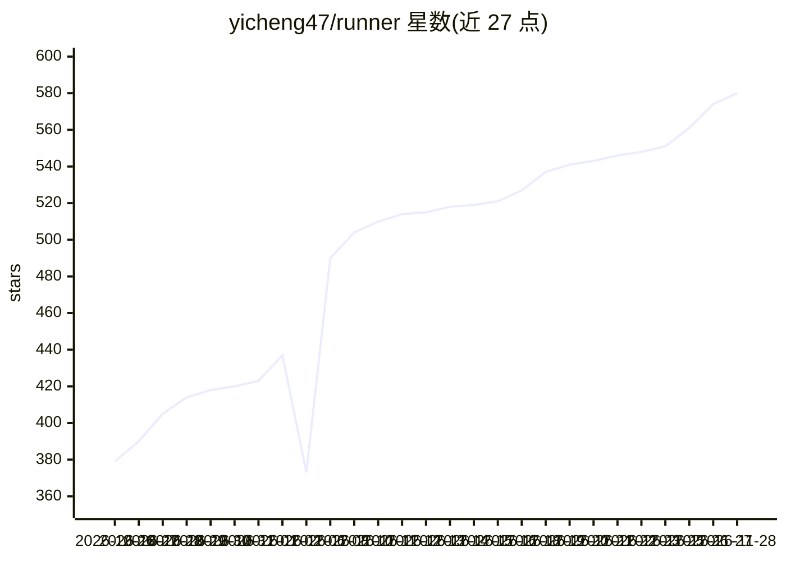

# yicheng47/runner

⭐ 580 · Rust · MIT · 推送 2026-11-27 · [GitHub](https://github.com/yicheng47/runner) · [官网](https://runnersh.dev/) · 个人维护 · 中文 README

**让多个终端编码 Agent 在同一任务中协作的桌面终端管理器**

一款运行于 macOS/Windows（Linux beta）的桌面应用，把 Claude Code、Codex、Antigravity CLI、pi 等 CLI 编码代理组成可复用的 crew，在同一 mission 中各自保持真实 PTY 终端并共享协调 feed。提供 .crew.toml/.role.toml 导入导出、runner CLI、后台服务 runnerd 使会话在应用关闭后持续运行、iOS TestFlight 远程查看（中继服务器私测，限中国大陆）、MCP/Skills 统一管理、文件侧栏与多种主题。会话与历史保留在本机。

## 筛选速览

| 维度 | 判定 | 备注 |
|---|---|---|
| AI 角色 | `ai-ecosystem` | LLM/agent 周边工具 |
| 许可风险 | `permissive` | MIT |
| 部署形态 | `desktop` | 安装包/桌面程序 |
| 模型依赖 | — | README 未给出锁定关系 |
| 硬件要求 | — | 无带数字的原话,不猜 |
| 安装摩擦 | `low` | 无编译、无系统依赖或容器化 |
| 成熟度 | `idea` | |

## 能力要点

- 可复用 crew：保存角色组合与团队约定，支持 .crew.toml/.role.toml 离线导入导出
- 每个 Agent 在真实 PTY 终端中保持独立 TUI（基于 alacritty_terminal）
- runnerd 后台服务：关闭应用后会话与终端仍持续存在
- runner CLI 可从脚本启动聊天/crew 并跟踪 mission（--json 支持）

## 适用场景

- 让 coder 与 reviewer 两个 Agent 在同一任务中交接协作
- 在 iPhone 上远程查看和应答电脑上运行的 Agent 会话
- 统一管理多个 Agent 的 MCP 服务器与 skills 配置

## 场景标签

`多智能体` `编码 Agent` · 领域:Agent 开发

## 证据(README 行号)

> L17:  Claude Code, Codex, Antigravity CLI and pi on the same task, in one mission. Each agent keeps its own TUI in a rea
> L43: Runner brings CLI coding agents together in reusable crews, with real terminals and a shared mission feed. Your ses
> L74: - **The `runner` CLI** — Your agents, scripts and terminal can start chats, launch crews and follow missions with t

## 星数曲线

2026-10-26 379 → 2026-11-28 580（+201）

---
*卡片 v1 · prompt 1.4 · 生成 2026-11-28 · 置信度 high · 依据 README sha `a797e4d31881` · [字段定义](../../DATASET.md)*
