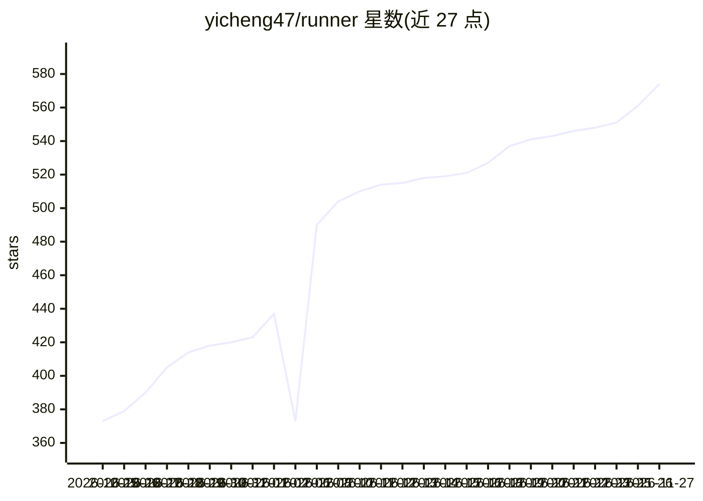

# yicheng47/runner

⭐ 574 · Rust · MIT · 推送 2026-11-26 · [GitHub](https://github.com/yicheng47/runner) · [官网](https://runnersh.dev/) · 个人维护 · 中文 README

**在同一任务上编排多个终端编码 Agent 的桌面应用**

Runner 把 Claude Code、Codex、Antigravity CLI、pi 等 CLI 编码 Agent 组织成可复用的 crew，在同一任务（mission）中各自保留真实 PTY 终端与 TUI，并通过共享任务 feed 协调交接。支持每个槽位的 Agent 与模型覆盖配置、会话由后台服务 runnerd 托管（应用关闭后继续运行）、`runner` CLI 驱动、iPhone 远程查看与应答（私有 beta 中继）、MCP 与技能统一管理。原生支持 macOS（Apple Silicon/Intel）与 Windows x64，Linux 为 beta。

## 筛选速览

| 维度 | 判定 | 备注 |
|---|---|---|
| AI 角色 | `ai-ecosystem` | LLM/agent 周边工具 |
| 许可风险 | `permissive` | MIT |
| 部署形态 | `desktop` | 安装包/桌面程序 |
| 模型依赖 | — | README 未给出锁定关系 |
| 硬件要求 | — | 无带数字的原话,不猜 |
| 安装摩擦 | `low` | 无编译、无系统依赖或容器化 |
| 成熟度 | — | 结构信号不足 |

## 能力要点

- 可复用 crew：多个 Agent 在同一 mission 中协作，共享 feed 协调并向用户提问
- 每个 Agent 保留独立真实 PTY 终端，基于 alacritty_terminal 与 GPUI 渲染
- 后台服务 runnerd 使 Agent 在应用关闭后继续运行并可恢复会话
- `runner` CLI 支持脚本/终端/Agent 启动聊天与任务，支持 --json

## 适用场景

- 让 coder 与 reviewer 两个编码 Agent 组成 crew 完成实现与代码审查
- 在同一界面统一管理多个 CLI 编码 Agent 的会话、MCP 配置与技能
- 从 iPhone 远程查看终端、启动任务并应答 Agent 的提问

## 场景标签

`多智能体` `编码 Agent` `代码审查` · 领域:Agent 开发

## 证据(README 行号)

> L17:  Claude Code, Codex, Antigravity CLI and pi on the same task, in one mission. Each agent keeps its own TUI in a rea
> L43: Runner brings CLI coding agents together in reusable crews, with real terminals and a shared mission feed. Your ses
> L92: **First-tier:** Claude Code, Codex, Antigravity CLI and pi. These four runtimes are Runner's first-class citizens —

## 星数曲线

2026-10-25 373 → 2026-11-27 574（+201）

---
*卡片 v1 · prompt 1.4 · 生成 2026-11-27 · 置信度 high · 依据 README sha `2e07057f3b6c` · [字段定义](../../DATASET.md)*
