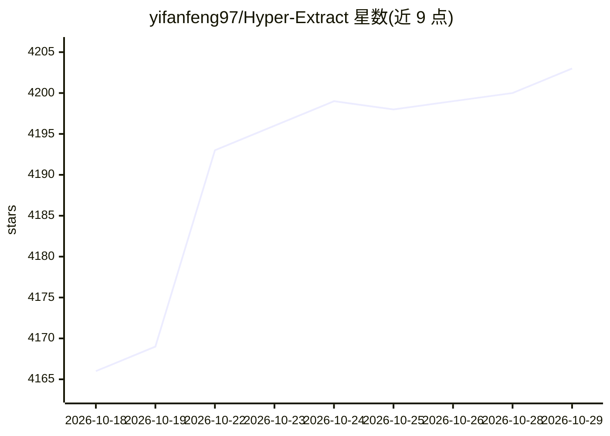

# yifanfeng97/Hyper-Extract

⭐ 4,203 · Python · NOASSERTION · 推送 2026-10-15 · [GitHub](https://github.com/yifanfeng97/Hyper-Extract) · [官网](https://yifanfeng97.github.io/Hyper-Extract/) · 个人维护 · 中文 README

**把文档转成结构化知识（图/超图/时空图）的 CLI 工具**

面向需要从非结构化文档中抽取结构化知识的开发者与知识库管理者。以 CLI（he 命令）与 Python API 双形式提供：读取 PDF/Word/Excel/HTML/EPUB 等格式，通过 11+ 抽取引擎（chunk_rag、GraphRAG、LightRAG、Hyper-RAG、KG-Gen 等）生成 9 种知识结构，含图、超图、时空图；提供 80+ YAML 模板覆盖金融/法律/医学等领域。基于 LLM function calling，需模型支持工具调用；支持增量演化与来源溯源，可导出 Obsidian/MCP。限制：依赖外部 LLM 提供商（OpenAI/Anthropic/Gemini/DeepSeek/百炼/vLLM），vLLM 本地部署需 GPU。

## 筛选速览

| 维度 | 判定 | 备注 |
|---|---|---|
| AI 角色 | `ai-ecosystem` | LLM/agent 周边工具 |
| 许可风险 | `none` | NOASSERTION |
| 部署形态 | `library` | 以包/库形式分发 |
| 模型依赖 | local-ok | 支持本地模型 |
| 硬件要求 | — | 无带数字的原话,不猜 |
| 安装摩擦 | `low` | 无编译、无系统依赖或容器化 |
| 成熟度 | — | 结构信号不足 |

## 能力要点

- 9 种知识结构（含超图、时空图）与 11+ 抽取引擎
- 80+ YAML 模板覆盖金融/法律/医学/中医等 6 个领域
- 增量演化与来源溯源：审计、回滚、更新文档
- MCP Server 暴露知识供 Claude Desktop/IDE agent 检索导出

## 适用场景

- 把学术论文或财报转成交互式知识图谱
- 本地 vLLM 部署做数据不出内网的知识抽取
- 维护与源文档同步、可审计回滚的知识库
- 导出 Obsidian vault 或通过 MCP 供助手检索

## 场景标签

`知识图谱` `文档解析` · 领域:知识与检索

## 证据(README 行号)

> L103: |🧠 **11+ Extraction Engines**|chunk_rag (zero-cost baseline), GraphRAG, LightRAG, Hyper-RAG, KG-Gen, and more — re
> L154: Hyper-Extract uses LangChain structured output with **function calling**. The model must support tool/function cal

## 星数曲线

2026-10-18 4,166 → 2026-10-29 4,203（+37）

---
*卡片 v1 · prompt 1.4 · 生成 2026-10-20 · 置信度 high · 依据 README sha `2a179e732432` · [字段定义](../../DATASET.md)*
